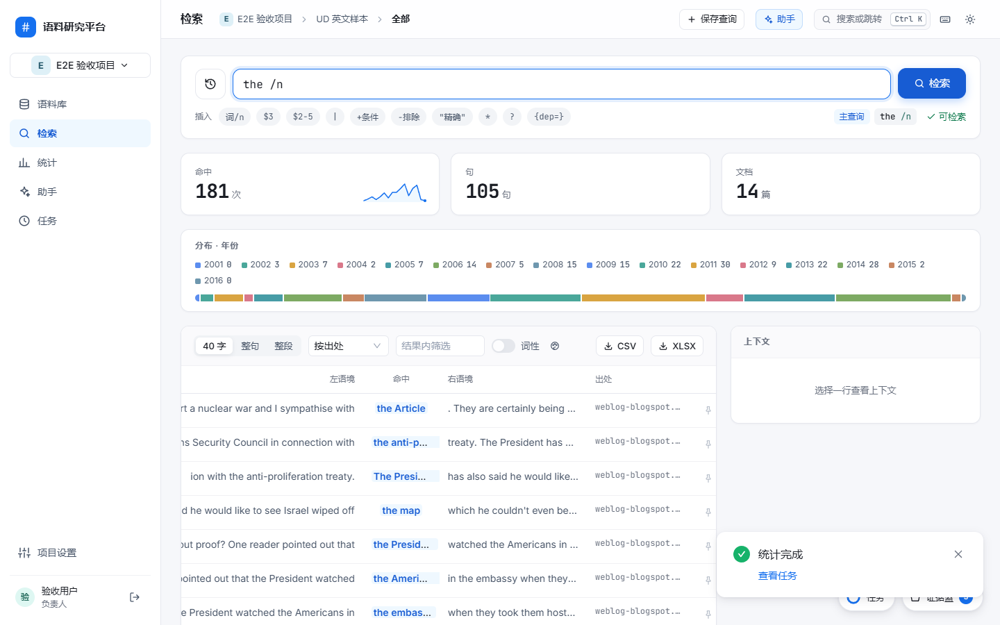
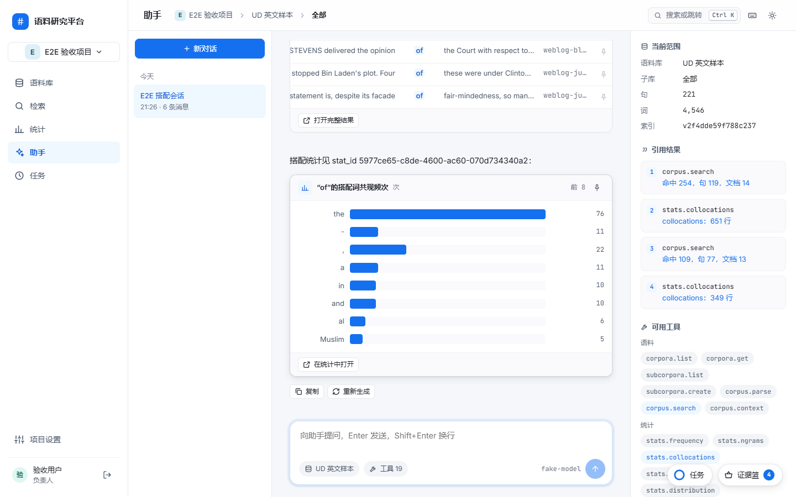
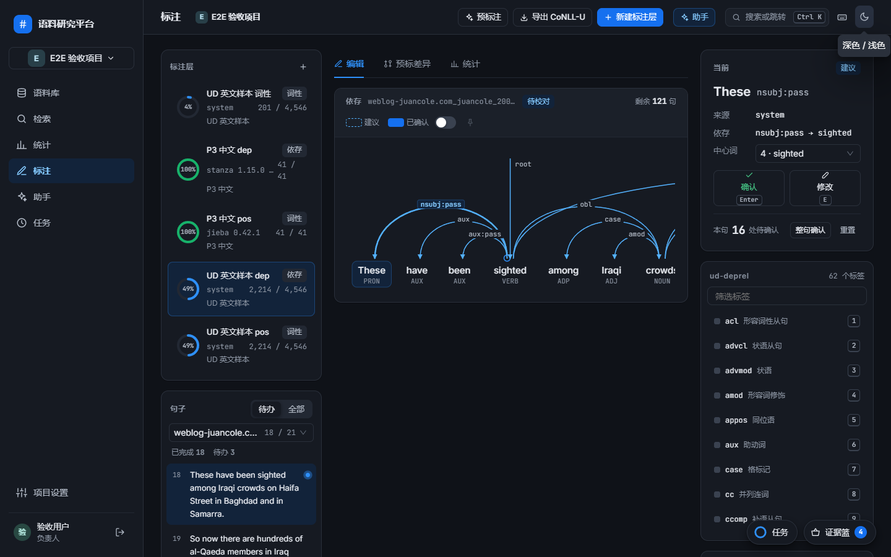
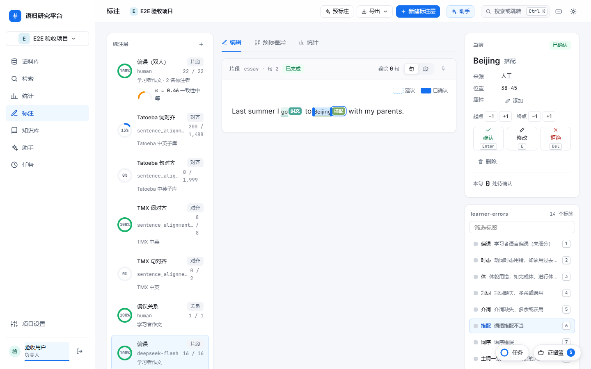
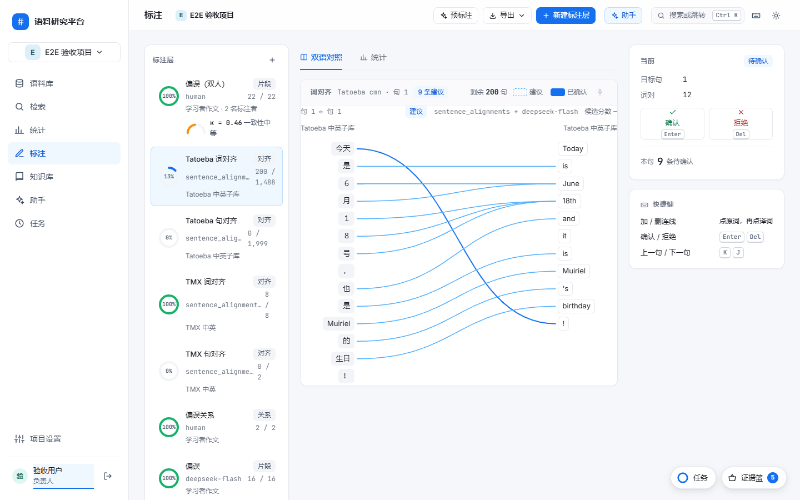
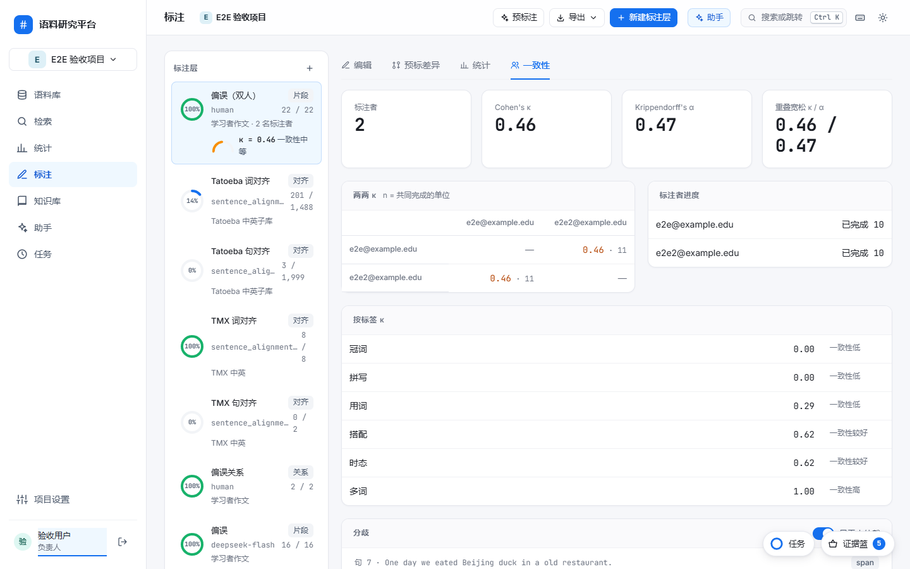
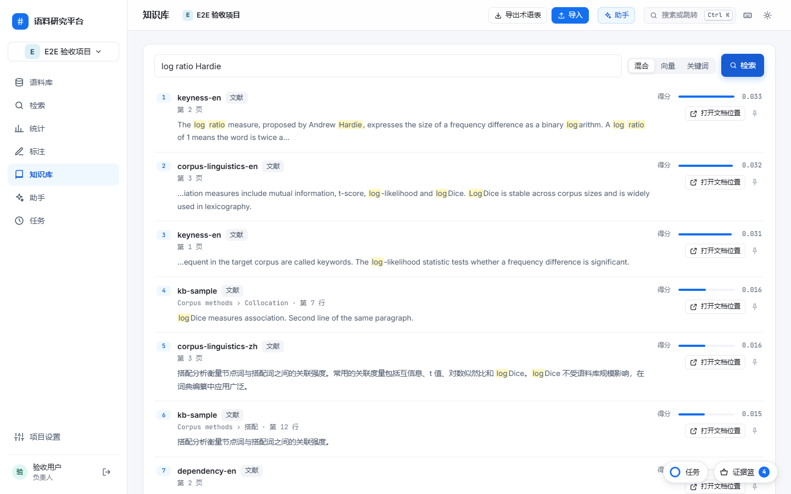
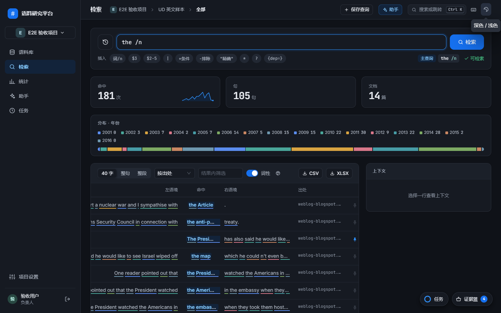
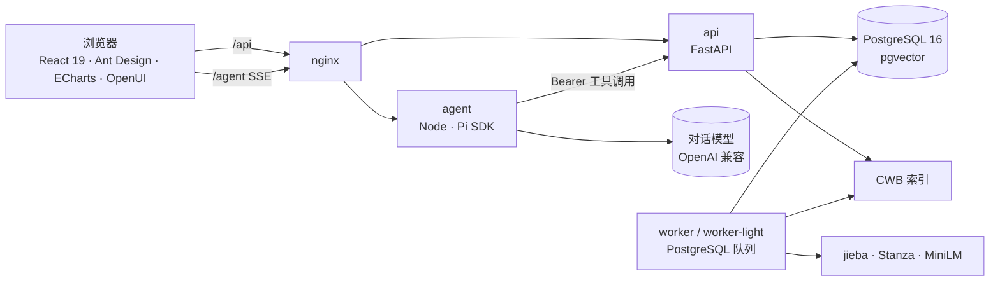

<div align="center">

# 语料检索、分析与标注研究平台

**类 CCL 检索 · 统计分析 · Agent 预标 + 可视化校对 · 知识库 · 内置研究助手**

面向高校外语、翻译和语言学研究生的一体化语料研究平台


[功能](#功能) · [界面](#界面) · [查询语法](#查询语法) · [架构](#架构) · [快速开始](#快速开始) · [文档](#文档) · [进度](#进度)

</div>

---

## 功能

| | 模块 | 能做什么 |
| :-: | --- | --- |
| 🗂️ | **语料库** | 导入 TXT / DOCX / CSV / TSV / CoNLL-U / TMX / Tatoeba；中文 jieba、英文 Stanza 自动分词词性依存；元数据子库；内置语料带许可署名 |
| 🔍 | **检索** | 类 CCL 查询式：字串、`词/n`、`$N` 间隔、`\|`、`+`/`-` 同句条件、`{pos= dep= lemma=}` 属性、`[标签]` 标注；KWIC、上下文、对齐句、分布条、导出 |
| 📊 | **统计** | 频次 · n-gram · 搭配（MI / logDice / t / LL）· 关键词（LL / log ratio）· 分布 · 标注与对齐统计；每个数字都能回到例句 |
| ✏️ | **标注** | 词性、依存、片段、关系、双语对齐五类层；Agent 预标 → 人工校对（弧线拖拽、拖选打标、连线对齐、全键盘）；多人一致性 κ / α 与仲裁；导出 CoNLL-U / brat / JSON / TMX / XLSX |
| 📚 | **知识库** | 文献（PDF / DOCX / MD / URL）、术语表（语料抽取、译名、TBX）、标注规范、研究笔记；向量 + 关键词混合检索，回答带出处 |
| 🤖 | **助手** | 基于 Pi SDK 的内置 Agent，37 个业务工具；回答内嵌 KWIC 表、频次图、依存树、对齐图、术语卡、知识引用等 14 种 OpenUI 组件；独立页 + 任意页面右侧抽屉 |
| ⚡ | **全局** | 证据篮（钉住任何命中或数字）、命令面板 `Ctrl K`、任务托盘、快捷键 `?`、深色模式、首次引导页 |

## 界面

<table>
<tr>
<td width="50%"><br/><sub>检索 — 查询式辅助、计数、分布条、KWIC、上下文与对齐句</sub></td>
<td width="50%"><br/><sub>助手 — 真实模型调用工具后渲染 KWIC 表与频次图</sub></td>
</tr>
<tr>
<td><br/><sub>标注 — 依存弧线拖拽改中心词，键盘流校对</sub></td>
<td><br/><sub>标注 — 学习者偏误片段标注，Agent 预标后人工确认</sub></td>
</tr>
<tr>
<td><br/><sub>标注 — 双语词级对齐连线编辑</sub></td>
<td><br/><sub>标注 — 多人一致性 κ 矩阵、分歧与仲裁</sub></td>
</tr>
<tr>
<td><br/><sub>知识库 — 混合检索、片段高亮与出处</sub></td>
<td><br/><sub>深色模式</sub></td>
</tr>
</table>

## 查询语法

| 写法 | 含义 |
| --- | --- |
| `语言` | 字串，中文可跨分词边界 |
| `语言/n` `/v` | 词 + 词性（UPOS 或 ICTCLAS 短标签） |
| `语言 文化` | 相邻 |
| `语言 $3 文化` `$2-5` | 词距 |
| `语言\|语法` | 或 |
| `翻译/v +文化` `-文化` | 同句含 / 不含（以主查询为锚计数） |
| `"the"` `*` `?` | 精确词形、任意词、任意字符 |
| `{dep=nsubj}` `学生{dep=nsubj}` `{pos=VERB,dep=root}` | 依存、词性、词元属性（系统层或指定标注层） |
| `[偏误:时态]` `go[时态]` | 片段标签 |

三项计数（命中 / 句 / 文档）分开返回，总数未算完显示"计算中"，不用已返回行数冒充总数。

## 架构



- **engine/**：解析、分词标注、CWB 建索引与检索、查询语法编译、统计、知识库、对齐、一致性 — 纯 Python 包，不碰数据库
- **services/api**：权限、业务状态、接口；**services/worker**：导入、索引、统计、预标、导出、知识库任务（心跳、分队列）
- **services/agent**：Pi SDK 会话 + customTools + OpenUI Lang 流式输出；工具与手动操作共用同一套接口
- 唯一 `jobs` 表、本地卷、单机 Compose；没有消息队列和对象存储

## 快速开始

```bash
cp deploy/.env.example deploy/.env   # 填 POSTGRES_PASSWORD、PUBLIC_ORIGIN；对话模型填 MODEL_BASE_URL / MODEL_API_KEY / MODEL_ID
npm ci --prefix apps/web && npm run web:build
docker compose --env-file deploy/.env -f deploy/compose.yaml up -d --build
docker compose --env-file deploy/.env -f deploy/compose.yaml exec api python scripts/create_account.py --email you@example.edu --admin
```

打开 http://localhost:8080 → 引导页会带你建项目、导入语料、第一次检索、试试助手。内置语料用 `scripts/import_builtin.py tatoeba | ud | wiki` 导入；备份恢复用 `scripts/backup.sh` / `restore.sh`。

<details>
<summary><b>本地开发与测试</b></summary>

```bash
uv sync --frozen && npm ci --prefix apps/web && npm ci --prefix services/agent

uv run --frozen --with pytest pytest tests/engine -k "not cwb and not nlp" -q   # 纯 Python
npm run check                                                                   # 前端类型检查、构建、vitest
npm run agent:test                                                              # 助手服务（假模型）
docker compose --env-file deploy/.env -f deploy/compose.yaml run --rm test      # api + engine（真实 PostgreSQL、CWB、Stanza）
STACK_URL=http://localhost:8080 uv run pytest tests/integration -s              # 权限矩阵，对运行栈
```

`npm run web:dev` 起 5173 开发页（代理 /api、/agent），`PUBLIC_ORIGIN` 需加 `http://127.0.0.1:5173`。

</details>

<details>
<summary><b>工程结构</b></summary>

```text
apps/web/          前端
services/api/      FastAPI 接口与 Alembic 迁移
services/worker/   任务执行器
services/agent/    Pi 助手服务
engine/            语料引擎
scripts/           账号、内置语料导入、性能基线、备份恢复
contracts/         每阶段接口契约 p1–p6
deploy/            Compose、Dockerfile、nginx
doc/               设计文档（Markdown 维护源 + Word）、设计稿、审查记录
tests/             pytest · vitest · node:test
```

</details>

## 文档

| 文档 | 内容 |
| --- | --- |
| [平台重构设计](doc/语料检索分析与标注研究平台重构设计.docx) · [md](doc/platform-redesign.md) | 定位、功能、数据模型、查询语法、统计、标注、知识库、Agent、架构、计划与验收 |
| [前端整体设计方案](doc/前端整体设计方案.docx) · [md](doc/frontend-design.md) | 视觉系统、页面、组件、动效、交互与各阶段实现记录；设计稿 [doc/ui-design](doc/ui-design/index.html) 可直接打开 |
| [部署手册](doc/部署手册.docx) · [md](doc/deployment.md) | 环境、服务、变量、启动、升级、备份恢复、故障 |
| [contracts/](contracts/) | p1 语料与检索 · p2 统计与 Agent · p3 词性依存标注 · p4 知识库 · p5 片段对齐一致性 · p6 收尾 |
| [doc/reviews/](doc/reviews/) · [change-log](doc/change-log.md) | 审查记录与变更原因日志；协作规范 [AGENTS.md](AGENTS.md) |

## 进度

| 阶段 | 内容 | 状态 |
| --- | --- | :-: |
| P1 | 语料导入、索引、类 CCL 检索、子库、导出 | ✅ |
| P2 | 五种统计、证据篮、Pi 助手服务、OpenUI 组件、前端定稿 | ✅ |
| P3 | 词性与依存标注层、预标、校对、属性查询、CoNLL-U | ✅ |
| P4 | 知识库：文献、术语、规范、笔记、混合检索 | ✅ |
| P5 | 片段与关系、双语对齐、多人一致性与仲裁、brat / TMX | ✅ |
| P6 | 前端完成度审查 ✅ · 权限回归 ✅ · 备份恢复 ✅ · 内置语料与性能基线 ⏳ · 干净环境验收 ⏳ | 🔄 |

每个阶段：写契约 → 三方并行实现 → 整栈联调（真实 PostgreSQL、CWB、Stanza、真实模型）→ 验收 → 按功能提交。
