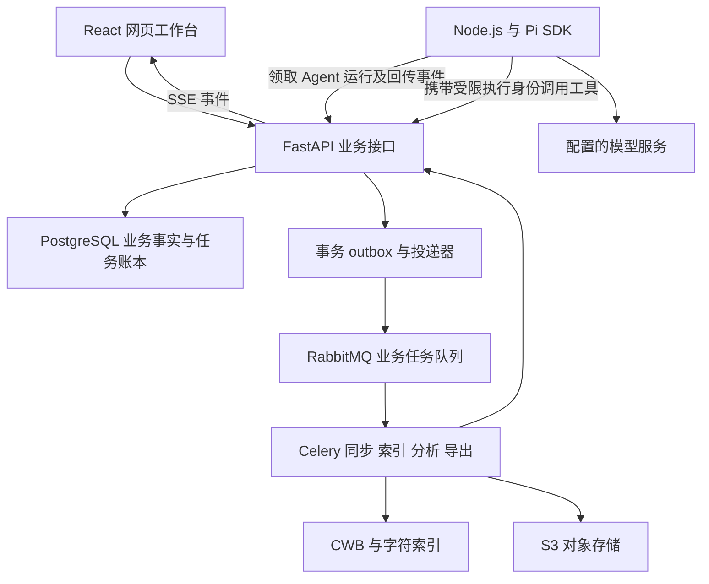

# 业务架构与 Pi 运行基线

首版服务高校外语、翻译和语言学研究生。业务主线为来源发布、项目选材、固定快照、检索分析、证据复查和成果导出。数据同步进入第一阶段。系统内置“研究助手”是项目主要能力，研究助手工作台作为默认入口，集中研究任务、过程、材料、证据与成果。助手基于 Pi SDK 改造；检索、分析和笔记仍可独立手动使用，与助手调用复用相同业务能力。Pi 是实现基础，不作为外置产品或原生 Pi 界面交付。

本基线落实 Pi 选型与业务架构审查，明确 AI 执行归属、会话状态、双语关系、查询语义和索引复用。完整产品范围沿用 M01 至 M14 和 F001 至 F096。实现门槛见[开发计划](development-plan.md)，页面与接口见[前端规范](frontend-specification.md)。

## 业务边界

### 用户和首版研究流程

研究者拥有自己的项目，可以邀请编辑或只读成员。平台数据管理员维护来源目录、许可与同步；该角色不自动取得私人项目材料的读取权限。项目负责人也不能越过来源的导出或模型外发限制。

首版必须完成两条研究流程：

1. 中英例句研究：从 Tatoeba 选择固定版本，检索双语例句，检查原始关系，在项目内修订一对一关系，保存证据及研究记录。
2. 子库比较：选择可比的中文或英文材料，固定两个子库，计算标准化频率和关键词差异，从数字返回例句并导出方法清单。

第一条开发演示先贯通真实 Tatoeba 同步、项目挂载、私有 TXT 导入、检索、Pi 引用和 CSV/JSON 导出。三类来源、完整统计和其余首版能力仍须在阶段 A 验收前完成。

### 核心业务对象

| 对象 | 含义 | 必须保持的规则 |
| --- | --- | --- |
| 来源目录项 | 发布方、数据集或发现入口 | 目录可发现与全文可分析分别登记；聚合入口不重复计入库规模 |
| 来源发布版本 | 一次获取的文件、记录与许可凭据 | 固定 manifest、校验和、上游 ID 及版本，发布后不可原地修改 |
| 来源快照 | 来源版本经过确定处理流程形成的可分析材料 | 绑定正文、token 层、处理配置与索引 |
| 项目挂载 | 项目使用某个固定来源快照的授权关系 | 不自动升级；每次读取检查当前授权 |
| 私有文档修订 | 用户上传并处理的项目材料 | 固定正文与码点坐标，不改写旧研究输入 |
| 研究快照 | 共享挂载和私有修订组成的固定材料集合 | 固定成员、顺序、处理版本与元数据；同一实际修订去重 |
| 查询与分析运行 | 在明确输入范围上执行的方法 | 保存完整参数、统计单位、结果与完成状态 |
| 证据 | 原文位置或统计结果行的引用 | 原文与结果两类分别建模，访问时重新鉴权 |
| 研究笔记与成果 | 人工接受的记录及可下载产物 | AI 草稿与人工确认分开，导出保留来源与方法 |
| Agent 会话与运行 | 对话上下文及一次用户任务的执行 | 固定项目和发起人；会话历史不能替代业务事实 |

来源能力分别登记 `discover`、`remote_query`、`fulltext_analysis`、`export`、`model_egress`。允许下载不自动等于允许外发模型。来源撤回会限制旧快照访问，历史不可变不能成为继续展示撤回正文的理由。

## 服务职责



| 服务或存储 | 唯一负责的事实或执行 | 接口边界 |
| --- | --- | --- |
| React + TypeScript + Vite | 展示项目、研究操作、工具进度和证据 | 只经 FastAPI；SSE 中断后重新读取持久状态 |
| FastAPI + Pydantic | 身份、授权、业务命令、状态转换、工具接口 | Node 与浏览器都不能直接绕过业务规则写项目结果 |
| SQLAlchemy + Alembic + PostgreSQL | 业务实体、运行租约、幂等记录、事件、结果引用 | 核心项目表使用复合约束与 RLS；共享来源使用独立域 |
| Node.js + TypeScript + Pi SDK | Agent 会话、模型循环、工具选择和流式输出 | 首版唯一 Agent 执行进程；通过内部 API 领取运行 |
| Celery + RabbitMQ | 同步、清洗、索引、统计、导出等后台业务任务 | 不启动第二套 Agent 循环；队列只是投递机制 |
| CWB/CQP 与字符位置索引 | 精确检索 | 共用规范化正文坐标，查询语义由本平台定义 |
| Stanza 与版本化语言管线 | 语言处理 | 保留来源已有 token/POS 层，模型结果不能覆盖人工确认 |
| pgvector | 语义资料发现 | 首版在授权范围内精确距离搜索，不提供语料频次答案 |
| S3 兼容对象存储 | 原件、正文、索引、会话归档、成果 | 私有对象键；读取通过业务授权，版本发布前完整校验 |

Pi 接入使用 `@earendil-works/pi-coding-agent` SDK，沿用其模型层；首版不另建 LangGraph 或第二套 Agent 框架。依赖版本与容器摘要在 S0 集成验证后锁定，不从上游 main 自动部署。Python 保持模块化业务工程，Node 是明确的 Agent 运行边界。

部署采用 Linux 与 Docker Compose，增加独立 `agent-runtime` 服务；数据库、队列及内部接口不直接暴露给浏览器。基础查询不依赖 GPU，模型服务可按部署环境外接。

## 数据同步与研究版本

来源连接器按确定程序执行。定时同步无需模型做决策；研究助手支持来源发现、状态读取和获准的业务操作，平台管理员可经手动入口或研究助手启动全局同步、治理目录、发布与撤回；普通用户只能执行其权限内动作。

阶段 A 必交 Tatoeba 中英直接句对、Wikimedia zhwiki/enwiki 正文、至少一个核准的 UD 树库。S0 锁定包、版本、许可、语言、抽样方法与容量；46 项来源登记继续维护实际接入状态。

```text
发现版本 → 下载 → 校验 → 解析 → 质量检查 → 建立索引 → 原子发布
                                              ↓
项目挂载固定版本 + 私有上传 → 研究快照 → 检索与统计 → 证据与成果
```

下载和索引失败不能替代当前可用版本；更新发布不自动改变既有项目挂载。只有完整清单或官方撤回事件能判定上游删除。样本范围、排除记录和真实规模写入 manifest，不能把开发样本标为完整库。

私有上传在 S1 建上传会话和私有对象路径，S3 完成 TXT，S4 补齐 CSV、TSV、JSONL。私有导入与来源同步共用规范化、质量报告和快照构建规则，但不能混用存储身份和权限。

### 索引复用

首版有两条明确路径。整库挂载且正文、token 层、顺序、处理配置完全相同，复用不可变来源索引；子集或共享私有混合快照构建受配额限制的项目索引。首版不要求跨分片联合查询。

索引键必须包括索引引擎版本、字符或 token 单位、规范化配置、recipe 摘要、有序成员修订清单及各成员 token 层摘要，不能只用原文件内容 hash。可影响查询的元数据另存版本化清单，运行必须固定该清单；无法独立过滤的属性改变时重建索引。

物理索引可复用不代表访问授权可复用。每个项目仍有自己的挂载、快照及授权校验；复用检测不向普通用户泄露其他项目材料是否存在。

## 检索与统计契约

查询使用平台 `corpus-query/v1` AST，不能把用户输入直接传给 CQP。字符路径支持跨分词边界的字串与字距；token 路径支持词项、词距及已有属性。两条路径返回同一正文的 Unicode 码点区间，采用左闭右开表示。

### 布尔过滤与命中跨度

首版使用“正向匹配 + 范围过滤”。界面和 AST 必须显式区分主查询与条件：

- `A AND B`：主查询 A 的每个命中作为锚点，B 只检查同句是否存在；不产生 A、B 的笛卡尔积。
- `A NOT B`：返回所在句没有 B 的 A 命中。
- `A OR B`：按正文修订和起止跨度取并集；相同跨度只计一次。
- 纯 `NOT B` 没有正向锚点，首版拒绝并要求补充主查询。
- 默认布尔范围是同句，二次过滤可明确选择同段。上下文显示窗口不改变查询范围。

一句出现两个 A 和三个 B 时，`A AND B` 的命中数是 2、匹配句数是 1；`B AND A` 是 3。界面必须显示“主查询 A，条件 B”，不能用看似对称的布尔表达式掩盖锚点选择。高级任意嵌套布尔语法不在首版范围。

`total_hits`、`matched_segments`、`matched_documents` 分开返回。统计从完整选定范围计算，分页、双语展开行和抽样展示不改变总体分母。异步计数未完成时总数为 null，不能把已返回行数当全库总数。

### 双语关系与项目修改

共享 `source_alignment_edges` 固定在来源版本中，记录稳定的边 ID、两侧句段 ID 和来源证据。公共关系不可被学生项目修改。

项目通过 `alignment_overlays` 建私有覆盖层。层固定 `project_id` 与 `snapshot_id`，共享关系另记可选 `source_release_refs`；纯私有双语材料也可创建覆盖层，不要求挂载或基础来源边。追加提交记录 `base_edge_id`、操作、两侧端点、确认状态及修订号。新增关系没有 base edge，必须保存明确端点；替换、拒绝和确认必须引用可访问的基础边或项目边。所有端点必须属于项目固定材料范围。

研究运行固定 `alignment_overlay_revision`，不能读取“最新覆盖层”重算旧结果。来源升级后生成迁移候选，人工确认不自动跨版本继承。两个项目挂载同一来源，甲的修订不改变乙，也不改变甲的旧运行。

双语结果分别返回 `matched_source_segments`、`matched_target_segments`、`matched_edges` 和用于展示的 `display_rows`。一个中文句子对应三个英文句子时，中文唯一句数是 1、英文唯一句数是 3、关系数是 3。单语词频按唯一材料计数，关系层分析才按边计数。导出保留两侧 ID、边 ID、覆盖层版本和 `counting_unit`。

自动对齐作为后台业务任务，为共享或私有固定材料生成一对一句级候选、匹配分数、复查原因及未配对清单。项目保存候选和一对一修订，复杂多对多关系仍只读；AI 建议不能标为人工确认。任务、候选、算法基线及工具输入输出见[研究助手业务能力与工具契约](assistant-capabilities.md)。

## Pi 会话与业务执行

### 状态权威和首版接口

Pi SessionManager 维护最终模型上下文及分支，PostgreSQL 维护业务运行、授权、任务和成果。会话转录归档到私有对象存储，数据库保存归档指针与校验摘要。界面消息表只作投影，不重新拼装另一份权威上下文。

| 对象 | 最小字段和约束 |
| --- | --- |
| agent_sessions | session_id、workspace_id、scope_kind、project_id（project 作用域必填）、owner_id、input_scope、scope_digest、resource_manifest、pi_version、context_archive_ref、context_hash、active_run_id、lease_epoch；首版每个用户自己的会话，不共享多人续写 |
| agent_runs | run_id、session_id、actor_id、input_scope、scope_digest、policy_epoch、state、attempt、lease_token、model_config、deadline、budget、final_result_ref |
| tool_invocations | invocation_id、run_id、pi_tool_call_id、tool_name、schema_version、args_hash、scope_digest、state、job_id 或 result_ref；稳定 invocation_id 为幂等主键 |
| agent_events | run_id、event_id、sequence、kind、payload_ref；同事件重复写入幂等，SSE 序号单调 |
| agent_run_jobs | run_id、invocation_id、job_id、ownership、cancel_policy；区分专属任务与复用任务 |
| session_evidence_refs | session_id、来源修订或结果引用、policy_epoch；覆盖消息、工具结果及摘要依赖 |

浏览器创建会话、提交消息、取消与重连均经 FastAPI。内部 API 按领取、心跳、事件提交、工具调用和结束运行分别设计，所有写入验证 run attempt 与 lease token。Node 首版通过内部长轮询领取待执行 Agent 运行，不直接消费 Celery 协议。

会话作用域为 account、platform 或 project。登录用户可在 account 会话创建项目；平台管理员可在 platform 会话执行目录、同步与策略管理；项目只读成员可创建 project 会话执行获准的查询，每次写入单独鉴权。平台权限不赋予私人项目读取权。

会话创建时绑定 input_scope 与 scope_digest。切换快照或材料范围必须新建会话，旧消息与工具摘要不带入；已有 run 的输入范围保持不变。提交消息时的范围与会话绑定范围不一致，返回 `409 SESSION_SCOPE_CHANGED`。

创建项目、快照或覆盖层修订后，旧 run 仅取得新 ID、计数和 scope_effect，不读取新范围正文。若用户已经授权后续分析，服务端保存仅含目标引用、业务步骤、结构化参数和原授权引用的 continuation_intent；旧 run 完成并关联 next_session_id，宿主重新鉴权、创建新会话并重新读取材料。网页可连续展示任务链，Pi 不继承旧正文、消息或摘要；旧排队消息不得自动迁移。完整衔接见[工具契约](assistant-capabilities.md)。

内部执行凭据由服务端生成，绑定 actor、scope_kind、project（项目作用域）、session、run、允许工具、数据外发范围、有效期及租约。模型仅提供工具业务参数，不能指定或扩大执行身份。每次工具调用和发布仍校验当前权限，凭据的旧授权快照不能绕过撤回。

### 单写与恢复

同一 session 同时只有一个执行租约和一个活动 run。普通新消息在忙碌时返回 `409 SESSION_BUSY`；首版提供明确的 follow-up 队列，消息持久化后由当前执行者在运行结束后消费。用户排队消息不能同时成为当前 run 的 steer；首版网页暂不开放 steer 控件。

接管会话必须先确认旧租约过期，再提升 lease epoch。会话暂存目录按 session 和 attempt 隔离；归档采用不可变对象加数据库条件切换指针，旧进程不能覆盖新上下文。恢复使用 Pi SessionManager 的受支持导入或打开方式，不能仅修改 agent 内存消息。

服务重启从最近完整会话检查点恢复；对已登记工具先核对业务执行结果，再补回工具结果。没有可靠检查点或不明确的模型请求进入 `WAITING_REVIEW`，禁止猜测历史并重放写操作。模型文本增量可以丢弃后重建，已发布业务成果不能丢失。

### 工具调用与长任务

研究助手调用当前用户有权限的全部已上线业务能力，包括创建、编辑、执行、修订、任务控制和管理能力。M01 至 M14 的业务动作随模块同批注册，后续 F001 至 F096 能力上线时同批接入。注册表显式映射同一个后端 command/query，不提供万能 API 或通用 shell。完整能力表、输入输出及权限见[研究助手业务能力与工具契约](assistant-capabilities.md)。已授权且目标明确的可逆写入直接执行，破坏性或目标不明的操作核对具体影响；用户明确核对的内容才可记录人工确认。工具进入调用前，服务端登记 invocation_id 并固定参数摘要。网络重试和恢复沿用该 invocation_id；同 ID 不同参数返回冲突。

工具结果统一为四类：

| 状态 | 必须返回 | 后续行为 |
| --- | --- | --- |
| succeeded | result_ref、evidence_refs、方法与版本摘要 | Pi 可读取结果并解释 |
| accepted | job_id、受限任务引用 | 等待或查询同一任务，不重新提交 |
| failed | code、可读原因、retryable | 按明确重试策略处理 |
| unknown | invocation_id、核对入口 | 查询原调用状态；禁止盲目重试写操作 |

模型在恢复后生成新的 tool call ID，不等于新的用户写入意图。笔记草稿、导出等写入同时绑定服务端分配的 action_id；恢复沿用原 action。新参数或重新生成成果形成显式新动作，不能靠工具调用 ID 改变绕过去重。

同步、索引和统计的耗时工作留在 Celery。Pi 的 HTTP 工具只提交任务、等待受限状态或取结果；必要结果尚未完成时，业务运行进入 `WAITING_JOB`。恢复后按 job_id 接续，不让模型持续空转轮询。

### 完成与取消

业务运行状态至少包含 `QUEUED`、`RUNNING`、`WAITING_JOB`、`WAITING_REVIEW`、`CANCEL_REQUESTED`、`CANCELLED`、`SUCCEEDED`、`FAILED`。普通工具失败可以由 Agent 处理；只有业务发布条件满足才能成功。

Pi 的低层 `agent_end` 不作为业务完成事件。收到 `agent_settled` 后，仍需核对租约、取消状态、必要工具结果、引用和最终产物；会话检查点与结果引用持久化后，FastAPI 才在条件事务中发布 `SUCCEEDED`。排队的下一条用户消息开启新的 run。

取消先写业务账本并拒绝新工具，再通知 Pi abort。专属且可取消的子任务收到取消请求；被其他运行复用的任务只解除当前等待。所有取消都保留此前已发布成果；迟到事件和输出不能把取消状态改成成功。用户关闭网页仅断开订阅，不触发取消。

### 资源加载和权限变化

SDK 资源加载器只装入本项目审核的工具、提示词和 Skills。显式设置模型、凭据、会话目录和工具集合，不自动扫描服务器用户目录、上传材料中的 `.pi` 配置或任意扩展。首版不开放通用 bash、文件编辑、任意脚本和第三方扩展安装。

每次模型请求前检查项目、来源及模型外发策略。权限 epoch 改变时重新验证；撤回依赖或外发权限变化的会话立即暂停，历史回放也受限制。首版采用保守恢复：从仍有权限的材料引用创建净化后的新会话，旧摘要与旧工具正文不得复用。

每个模型请求登记证据依赖和实际外发记录；检查与外发在宿主侧串行控制，撤回阻止后续请求。已发往外部模型的内容不能承诺远程收回，按原有来源策略处理。未能精确追踪摘要依赖时，将整个会话标为受影响，不能假定摘要无敏感内容。

## 开工约束

S0 先验证真实来源包、中文查询语义和 Pi SDK 最小集成。S1 完成服务与状态契约，S3 交付第一条真实研究流程；每个阶段同批接入对应业务工具，S7 验证跨模块组合任务和完整 AI 场景。详细任务、依赖和验收见[首版开发计划](development-plan.md)。

## Pi 官方接口依据

以下接口行为依据官方当前文档核验于 2026 年 10 月 15 日；实现须针对 S0 锁定的版本验证：

- [Pi SDK](https://github.com/earendil-works/pi/blob/main/packages/coding-agent/docs/sdk.md)：会话与 SessionManager、忙碌时消息处理、事件订阅、资源与工具配置。
- [Pi 显式配置示例](https://github.com/earendil-works/pi/blob/main/packages/coding-agent/examples/sdk/12-full-control.ts)：宿主显式提供资源加载器和会话依赖。
- [Pi 扩展](https://github.com/earendil-works/pi/blob/main/packages/coding-agent/docs/extensions.md)：工具注册与生命周期扩展。

本平台的多租户授权、业务账本、幂等、取消传播与成果发布规则由以上业务契约定义，需要本项目实现和验收。
