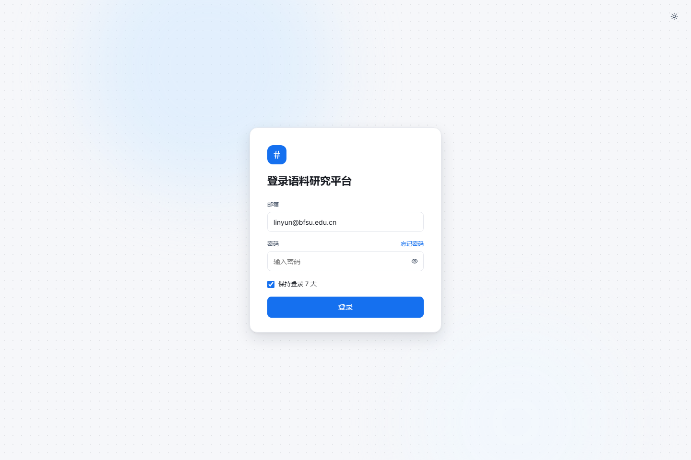
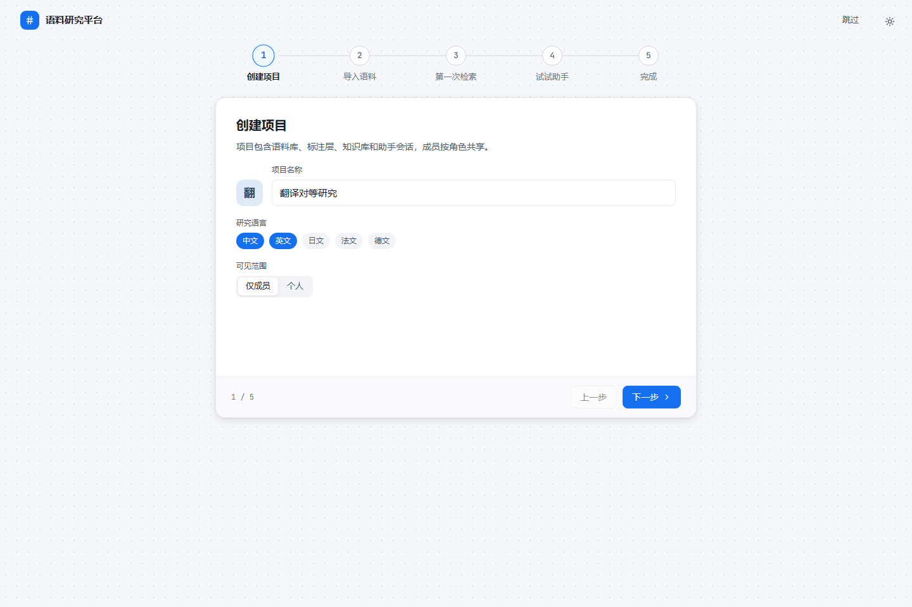
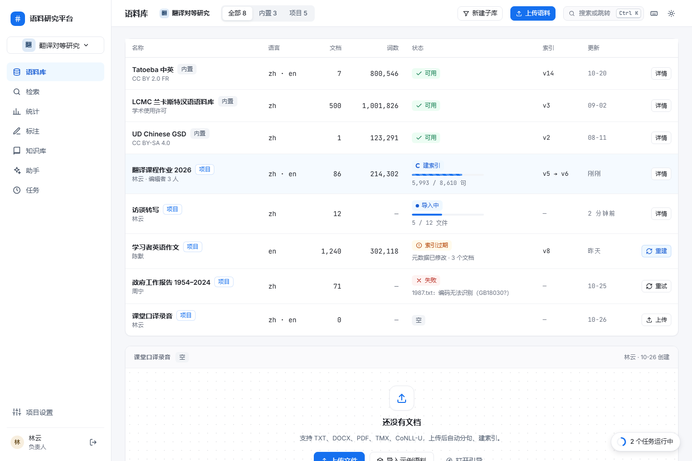
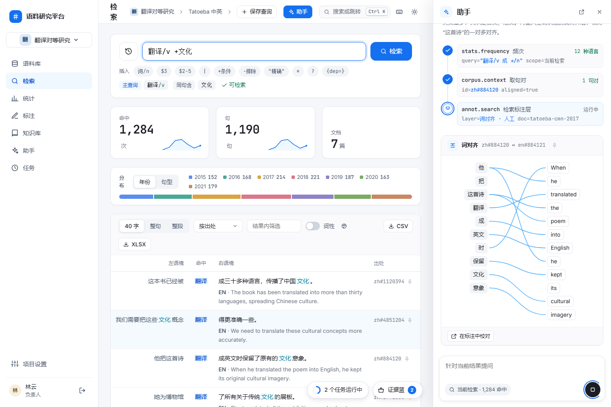
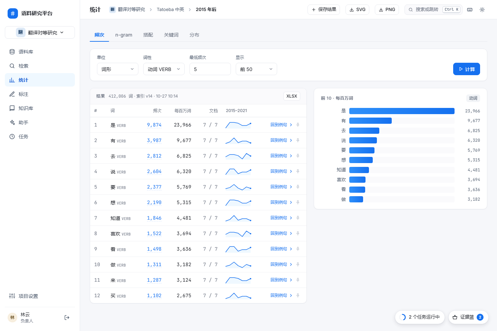
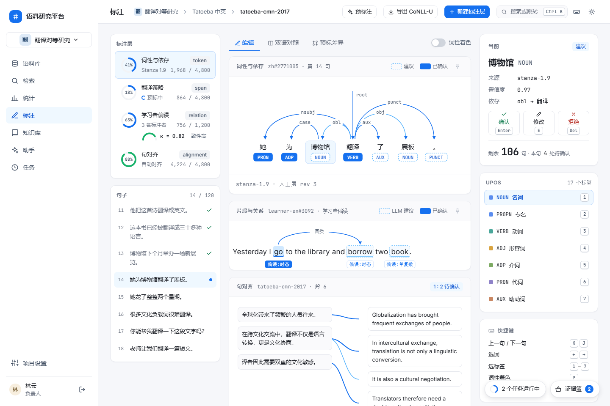
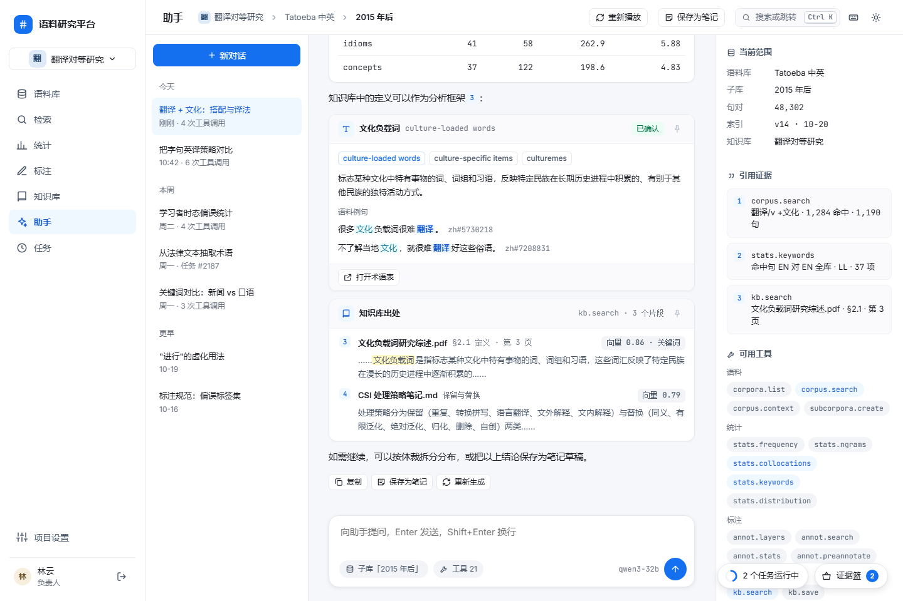
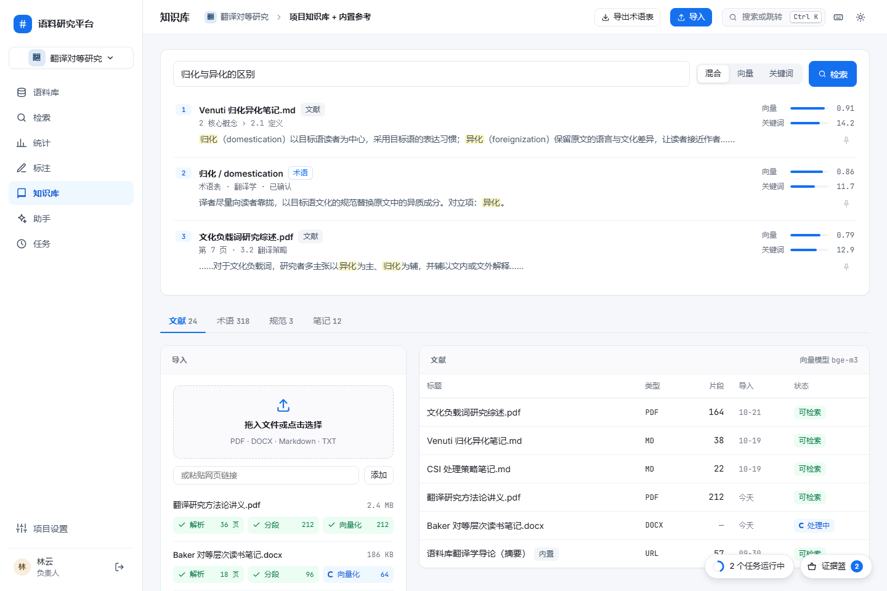
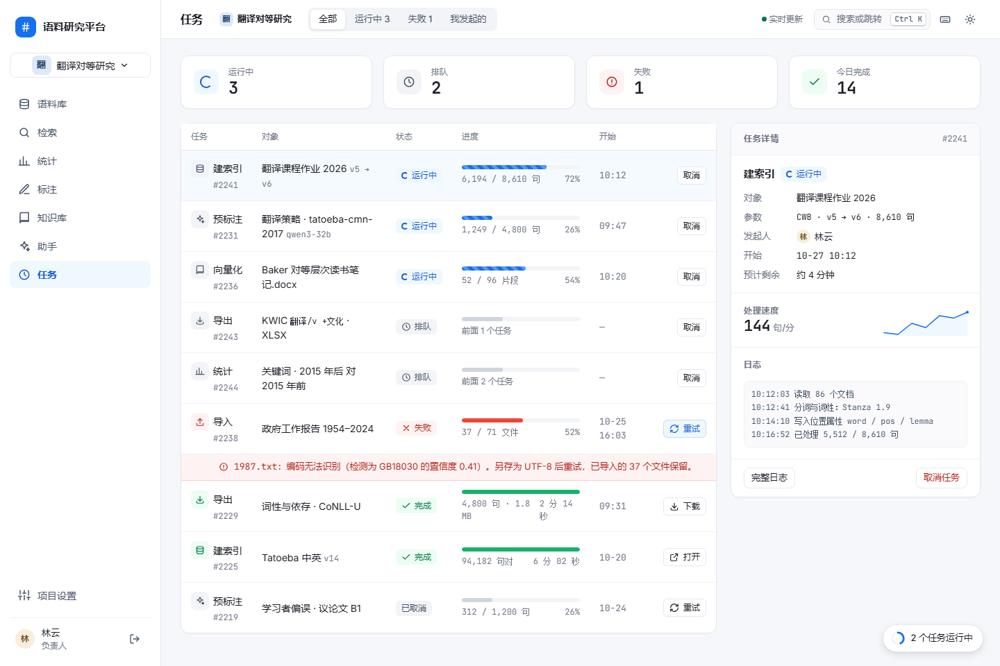
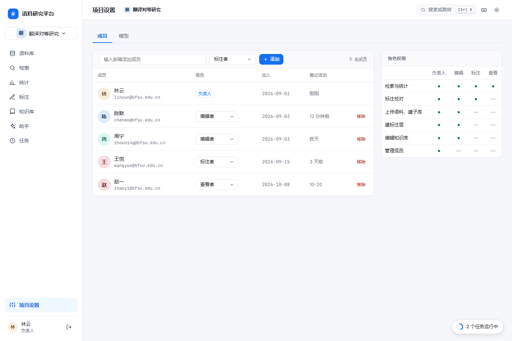

# 前端整体设计方案

2026 年 10 月 27 日。本文件说明前端的视觉、布局、页面、组件、动效与实现方式，产品范围以[重构设计](platform-redesign.md)为准，接口以 [P1 契约](../contracts/p1.md)为准。视觉基准是 `doc/ui-design/` 中的静态设计稿；本文只描述设计稿中已有的内容，设计稿未画的部分单独标为“实现约定”。

| 设计稿 | 内容 |
| --- | --- |
| `index.html` | 总览：页面入口、令牌、动效表 |
| `components.html` | 令牌表与 B1–B18 组件样本 |
| `motion.html` | 动效样本，可逐项重播 |
| `onboarding.html` | 首次登录引导 |
| 其余 11 页 | 登录、语料库、检索、检索 + 助手抽屉、统计、标注、助手、知识库、任务、项目设置 |
| `style.css` / `app.js` | 全部令牌与公共样式 / 公共交互（导航、命令面板、证据篮、任务托盘、思考链、依存树、对齐线） |

## 一 设计目标与风格

| 项 | 规则 |
| --- | --- |
| 风格 | 现代产品型：浅灰底 `#F6F7FA`、白色圆角卡片、柔和投影 |
| 强调色 | 单一蓝色 `#1570EF`；悬停 `#175CD3`；浅底 `#EFF8FF`；浅底上的文字用 `#175CD3` |
| 禁用 | 紫色主题色、卡片左侧色条、渐变装饰、插画、emoji |
| 信息密度 | 面向研究生：表格为主体，计数、码点、出处、索引版本直接显示；不加装饰性副标题和卡片脚注 |
| 字体 | 界面 Inter + PingFang SC / Microsoft YaHei；计数、坐标、编号、查询式、工具名用 JetBrains Mono |
| 状态表达 | 状态标签 + 文字；进度显示真实数值（如 `5,512 / 8,610 句`） |

## 二 布局框架


| 区域 | 尺寸 | 内容 |
| --- | --- | --- |
| 左导航 | 宽 232，白底，右侧 1 px 线，`position: sticky` 满高 | 品牌；项目切换按钮（字标 + 名称，点开命令面板“项目”组）；语料库、检索、统计、标注、知识库、助手、任务；底部项目设置；当前用户（头像、姓名、角色、退出）。选中项浅蓝底指示块滑动 |
| 顶栏 | 高 56，`rgba(255,255,255,.92)` + 8 px 模糊，底部 1 px 线 | 页面标题（16 / 600）；面包屑范围条（项目 › 语料库 › 子库或文档，每段可点）；页面主操作；命令面板入口（“搜索或跳转 Ctrl K”）；快捷键按钮；深色切换；检索页另有“助手”按钮 |
| 顶部进度线 | 高 2，贴顶栏底边 | 请求或任务进行时显示不定进度 |
| 主区 | 内边距 24 / 28，区块间距 20，卡片间距 16–20 | 页面内容 |
| 右侧检查器 | 宽 360 | 检索上下文、任务详情；头条 + 分段主体 + 底部操作 |
| 右下胶囊 | 距右 24、距底 20，高 40 | 任务托盘（所有带导航的页面）；证据篮（检索、统计、助手、标注、知识库）。面板宽 340，最高 440 |
| 详情抽屉 | 宽 640，遮罩 `rgba(16,24,40,.36)` | 语料库详情（文档、上传、元数据） |
| 助手抽屉 | 宽 420，满高，不加遮罩 | 主区右侧让出 420；检查器隐藏；右下胶囊左移到 444 |
| 命令面板 / 快捷键浮层 | 宽 640 / 560，距顶 12vh | 见第七节 |

### 宽度与断点

设计稿按 1440 × 960 绘制，`body` 最小宽度 1280，没有其他断点。

| 宽度 | 实现约定 |
| --- | --- |
| ≥ 1440 | 按设计稿 |
| 1280–1439 | 检查器改为覆盖式抽屉（360）；助手抽屉打开时顶栏次要按钮收进“更多” |
| < 1280 | 页面横向滚动，不做移动端布局 |

设计稿中检索 + 助手抽屉在 1440 下顶栏标题被挤成竖排（见第四节截图），实现时按上表收起次要按钮。

## 三 视觉令牌

令牌全部定义在 `style.css` 的 `:root`，深色模式在 `:root[data-theme="dark"]` 用同名变量覆盖。

### 颜色

| 变量 | 浅色 | 深色 | 用途 |
| --- | --- | --- | --- |
| `--bg` | `#F6F7FA` | `#0F1218` | 页面底色 |
| `--surface` | `#FFFFFF` | `#161A22` | 卡片、面板 |
| `--surface-2` | `#FAFAFC` | `#1B2029` | 卡片头条、表格悬停行 |
| `--line` | `#E6E8EE` | `#2A303B` | 卡片与控件描边 |
| `--line-soft` | `#F0F1F4` | `#222833` | 卡片内分隔线 |
| `--line-strong` | `#D0D5DD` | `#3A4250` | 控件悬停描边、键帽 |
| `--fill` / `--fill-hover` | `#F2F4F7` / `#EEF0F5` | `#222833` / `#283040` | 填充、悬停 |
| `--text` | `#1A1D24` | `#E6E9EF` | 正文 |
| `--text-2` | `#475467` | `#B4BCC8` | 次要文字 |
| `--text-3` | `#6B7280` | `#8C95A3` | 标签、表头、辅助 |
| `--text-4` | `#98A2B3` | `#5E6673` | 图标、占位符（不用于必读文字） |
| `--accent` | `#1570EF` | `#2E90FA` | 链接、焦点、线条 |
| `--accent-hover` | `#175CD3` | `#53B1FD` | 悬停 |
| `--accent-text` | `#175CD3` | `#84CAFF` | 浅蓝底上的文字 |
| `--accent-tint` / `-tint-2` | `#EFF8FF` / `#D1E9FF` | `#12233A` / `#173356` | 选中、命中底 |
| `--accent-fill` | `#F5FAFF` | `#131D2B` | 选中行 |
| `--accent-line` | `rgba(21,112,239,.2)` | `rgba(46,144,250,.32)` | 强调描边 |
| `--accent-solid` | `#1570EF` | `#1570EF` | 白字底色：主按钮、发送、已确认标签 |
| `--mark-bg` | `#FEF7C3` | `#3D3510` | 知识库片段高亮 |
| `--hit2` / `-bg` | `#0E7090` / `#ECFDFF` | `#67E3F9` / `#0B2A33` | 同句条件命中 |
| `--backdrop` | `rgba(16,24,40,.36)` | `rgba(0,0,0,.55)` | 遮罩 |
| `--dot` | `rgba(16,24,40,.09)` | `rgba(255,255,255,.07)` | 点阵底纹 |

### 语义色

| 语义 | 文字（浅 / 深） | 浅底（浅 / 深） | 描边（浅） | 实色 | 用途 |
| --- | --- | --- | --- | --- | --- |
| 成功 | `#067647` / `#47CD89` | `#ECFDF3` / `#0E2A1C` | `#ABEFC6` | `#17B26A` | 可用、完成、已确认 |
| 警告 | `#B54708` / `#FDB022` | `#FFFAEB` / `#2E2210` | `#FEDF89` | `#F79009` | 索引过期、改动 |
| 错误 | `#B42318` / `#F97066` | `#FEF3F2` / `#33171A` | `#FECDCA` | `#F04438` | 失败、拒绝 |
| 信息 | `#175CD3` / `#84CAFF` | `#EFF8FF` / `#12233A` | `rgba(21,112,239,.2)` | `#1570EF` | 运行中、提示 |

文字色用于标签和提示，实色用于进度条、圆点、进度环。

### 分类色板

8 色低饱和，用于词性、标签集、图表系列。`--cN` 为图形色，`--cN-bg` / `--cN-fg` 为标签底与字。

| 序号 | 词性映射 | `--cN` | 浅底 / 字 | 对比 | 深底 / 字 | 对比 |
| --- | --- | --- | --- | --- | --- | --- |
| c1 | NOUN、PROPN | `#5B8DEF` | `#EAF1FD` / `#1E4F9A` | 7.0 | `#17253D` / `#9DBCF5` | 8.0 |
| c2 | VERB | `#4AA79A` | `#E4F4F1` / `#1D6458` | 6.1 | `#132C29` / `#8FD3C8` | 8.7 |
| c3 | ADJ | `#D9A441` | `#FBF1DD` / `#7A5210` | 6.2 | `#2E2414` / `#E8C783` | 9.4 |
| c4 | ADV | `#D9788A` | `#FBE9EC` / `#922C40` | 6.8 | `#33191F` / `#EEA9B6` | 8.5 |
| c5 | PRON | `#479CA6` | `#E5F1F2` / `#005A64` | 6.9 | `#08282C` / `#91C7CD` | 8.3 |
| c6 | ADP | `#7DAA63` | `#EAF3E4` / `#3A6324` | 6.2 | `#1C2A15` / `#B3D39F` | 9.2 |
| c7 | AUX、PART | `#C98762` | `#F8EBE3` / `#86411D` | 6.5 | `#2F1E15` / `#E3B79E` | 8.8 |
| c8 | DET、NUM、CCONJ、SCONJ、PUNCT、X | `#6E97AE` | `#E6EFF4` / `#2F5568` | 6.9 | `#17252D` / `#A9C7D7` | 8.8 |

系列色只用于图形和下划线，必须配图例或文字，不作文字颜色。

### 字体与字号

| 角色 | 规格 |
| --- | --- |
| 页面标题 | 16 / 600 |
| 卡片与抽屉标题 | 14–16 / 600 |
| 区块小标题 | 12 / 600，字距 .06em，`--text-3` |
| 正文、表格 | 14 / 400，行高 1.5；KWIC 行高 1.6 |
| 表头、标签、辅助 | 12 / 500；次要 13 |
| 计数 | JetBrains Mono 28 / 700，等宽数字，字距 -.02em；单位 13 / 500 |
| 查询输入框 | JetBrains Mono 16 |
| 查询式块、ID | JetBrains Mono 12–12.5 |
| 键帽 | JetBrains Mono 11 / 500 |
| 助手回答 | 14.5，行高 1.8；抽屉内 13.5 |

### 圆角、阴影、间距

| 令牌 | 值 | 用途 |
| --- | --- | --- |
| `--radius-sm` | 6 | 标签、小按钮、键帽（5） |
| `--radius` | 8 | 按钮、输入框、列表项 |
| `--radius-lg` | 12 | 卡片、检查器、结果组件 |
| `--radius-xl` | 16 | 浮层、对话框、证据篮面板 |
| 全圆 | 999 | 胶囊、chip、开关、进度条 |
| `--shadow-card` | `0 1px 2px rgba(16,24,40,.04)` | 卡片 |
| `--shadow-pop` | `0 4px 12px rgba(16,24,40,.10), 0 1px 3px rgba(16,24,40,.06)` | 浮层、胶囊、结果组件悬停 |
| `--shadow-dialog` | `0 20px 48px rgba(16,24,40,.18), 0 4px 12px rgba(16,24,40,.08)` | 对话框、抽屉、面板 |
| 间距 | 4 / 8 / 12 / 16 / 20 / 28 | 控件内 4–12；卡片内边距 18 × 20；卡片间 16–20；主区 24 / 28 |
| 控件高度 | 26 / 30 / 36 / 44 | xs / s / 默认 / lg（查询框、主检索按钮） |

## 四 页面清单

每页覆盖正常、空、处理中、失败四种状态。表中“设计稿”列说明该状态在设计稿中的位置；未画的按第十节通用规则实现。

### 4.1 登录



| 项 | 内容 |
| --- | --- |
| 用途 | 邮箱登录 |
| 区域 | 居中卡片 400 宽（品牌、标题、邮箱、密码 + 显示切换、忘记密码、保持登录 7 天、登录按钮）；背景点阵 + 两块浅蓝光斑缓慢漂移 |
| 操作 | 登录 → `POST /auth/login`；成功后首次用户进入引导，否则进入上次项目 |
| 状态 | 处理中：按钮转圈“登录中”并禁用；失败：卡片内红色提示“邮箱或密码错误”+ 卡片抖动；空密码同样抖动并聚焦密码框 |

### 4.2 引导页



| 项 | 内容 |
| --- | --- |
| 用途 | 首次登录五步：创建项目 → 导入语料 → 第一次检索 → 试试助手 → 完成 |
| 区域 | 顶部品牌与“跳过”；步骤条（编号圆点，已完成显示勾，进度线随步数增长）；单张卡片横向滑动切换；底部“n / 5”、上一步、下一步 |
| 操作 | 1 项目名称（实时生成字标）、研究语言多选、可见范围；2 选内置语料或上传，显示导入与建索引两条进度；3 预填 `翻译/v +文化`，检索后显示命中、句计数与 3 行 KWIC；4 迷你助手演示；5 汇总卡（项目、语料与索引版本、已保存查询、助手模型与工具数）+ 检索 / 标注 / 知识库入口，“进入检索” |
| 状态 | 导入中：条纹进度 + 数值，标签“导入中 → 建索引 → 可检索”；失败：显示任务错误并可重试；← → 键切换步骤 |

### 4.3 语料库



| 项 | 内容 |
| --- | --- |
| 用途 | 内置与项目语料列表、上传、元数据编辑、子库管理 |
| 区域 | 顶栏：范围（项目）、分段“全部 / 内置 / 项目”、新建子库、上传语料；语料表（名称 + 内置/项目标签 + 许可或创建人、语言、文档、词数、状态、索引版本、更新、操作）；空语料库卡；子库构建器（条件行 + 实时预览文档/词/句对计数 + 保存）；已保存子库列表（名称、规模、所属语料、条件查询式块）；详情抽屉 640（计数、文档表、上传、元数据三个标签页） |
| 操作 | `GET /corpora?project_id=`；上传 `POST /corpora/{id}/documents`；元数据 `PATCH …/documents/{doc_id}`；重建 `POST /corpora/{id}/reindex`；子库 `GET/POST /projects/{id}/subcorpora`，筛选字段来自 `GET /corpora/{id}/metadata-fields` |
| 状态 | 正常：可用 + 索引版本；处理中：导入中（脉冲点 + `5 / 12 文件`）、建索引（条纹进度 + `5,512 / 8,610 句`，版本 `v5 → v6`）；过期：警告标签 + 原因 + “重建”；失败：错误标签 + 实际原因（`1987.txt：编码无法识别`）+ “重试”；空：新项目整页空态（导入示例语料、上传文件、打开引导 + 3 个内置语料卡），空语料库卡（上传文件、导入示例语料） |

### 4.4 检索


| 项 | 内容 |
| --- | --- |
| 用途 | CCL 式查询、三项计数、KWIC、上下文与双语对照、导出 |
| 区域 | 查询卡：历史按钮、查询输入（44 高，等宽 16）、检索按钮、语法插入 chip（`词/n`、`$3`、`$2-5`、`\|`、`+条件`、`-排除`、`"精确"`、`*`、`?`、`{dep=}`）、即时解析行（主查询 / 同句含 / 同句不含 + “可检索”或错误位置）；计数卡 ×3（命中、句、文档，前两项带年份迷你图）；分布条（年份 / 句型切换，图例带数值，点击一段即筛选并显示筛选 chip）；结果卡：语境长度分段（40 字 / 整句 / 整段）、排序、结果内筛选、词性着色开关与图例、CSV / XLSX、KWIC 表（左语境右对齐、命中居中、右语境 + EN 对齐句、出处、钉住）、分页；右侧检查器 360（上下文前后句、双语词对齐连线、文档元数据、索引版本、钉住、加入笔记）；查询历史左侧滑出面板 340 |
| 操作 | `POST /search/parse`（输入时）、`POST /search`、`GET /search/context`、`POST /search/export`、`POST /projects/{id}/queries`（保存查询） |
| 状态 | 计数未完成（`counts.complete=false`）显示“计算中”并带 `search_id` 重取，不用当前页行数代替；解析错误在解析行显示位置与原因（“第 n 个字符：引号未闭合”），检索按钮禁用；空结果：计数为 0 + 空态“没有命中”；失败：结果卡内错误提示带错误码 |

### 4.5 检索 + 助手抽屉



| 项 | 内容 |
| --- | --- |
| 用途 | 不离开检索页，针对当前结果提问 |
| 区域 | 抽屉 420：头部（助手、在助手页打开、关闭）；对话流（用户消息、思考链、回答、结果组件，示例为 AlignmentGraph）；输入框（“针对当前结果提问”）+ 范围 chip“当前检索 · 1,284 命中”+ 发送/停止 |
| 操作 | 同助手页；范围默认取当前检索的 `search_id` 与语料范围 |
| 状态 | 运行中：思考链展开，进行中工具步骤脉冲；停止：未完成步骤标“已取消”；失败：步骤节点变红并显示错误 |

### 4.6 统计



| 项 | 内容 |
| --- | --- |
| 用途 | 频次、n-gram、搭配、关键词、分布；数字可回到例句 |
| 区域 | 顶栏：保存结果、SVG、PNG；方法标签页（频次 / n-gram / 搭配 / 关键词 / 分布）；参数卡（每种方法一行表单 + 计算）；结果卡（标题行写规模、索引版本、计算时间，XLSX）+ 图卡。频次：表（词 + 词性、频次链接、每百万词、文档、年份迷你图、回到例句、钉住）+ 前 10 横向柱；n-gram：表；搭配：表（共现、MI、logDice、t、LL）+ 网络图 / 柱状切换（节点词居中，距离与线宽 = logDice，按词性着色）；关键词：表（目标、参照、LL、Log Ratio）+ 散点（Log Ratio × LL）；分布：纵向柱 + 明细表 |
| 操作 | P2 接口 `stats.frequency / ngrams / collocations / keywords / distribution`；频次数字点击打开检索 |
| 状态 | 计算中：结果卡骨架 + 顶部进度线，长任务进入任务托盘；空：无结果时表内空态，说明参数（如“最低频次 5 下无结果”）；失败：结果卡错误提示 |

设计稿未画“标注统计”标签页，P3 补。

### 4.7 标注校对



| 项 | 内容 |
| --- | --- |
| 用途 | 预标后逐句人工校对 |
| 区域 | 三栏 260 / 自适应 / 280。左：标注层列表（进度环、名称、类型、来源、完成数；多人层显示 κ 仪表）+ 句子流（序号、句子、已完成勾、当前蓝点）。中：视图标签（编辑 / 双语对照 / 预标差异）+ 词性着色开关；编辑视图含词性与依存（弧线图，词下方词性标签：虚线 = 建议，实心 = 已确认）、片段与关系（高亮片段 + 标签 + 关系弧）、句对齐（左右两栏连线，虚线待确认）；差异视图（改动 / 确认 / 拒绝计数筛选 + 上下两行对比）。右：当前项（词、标签、来源、置信度、依存、确认 / 修改 / 拒绝、剩余句数与本句待确认数）、标签面板（色块、标签、中文名、数字键）、快捷键 |
| 操作 | 预标注、导出 CoNLL-U、新建标注层；P3/P5 接口 `annot.*` |
| 状态 | 预标中：层列表显示“预标中”+ 进度环；空：无标注层时空态“新建标注层”；失败：预标任务失败在层列表显示错误并可重试 |

### 4.8 助手



| 项 | 内容 |
| --- | --- |
| 用途 | 对话调用全部工具，回复中渲染结果组件 |
| 区域 | 三栏 260 / 自适应 / 300。左：新对话 + 会话列表（今天 / 本周 / 更早；名称、时间、工具调用次数或任务号、运行中标记）。中：对话流 + 输入框（范围 chip、工具数 chip、模型名、发送 / 停止）。右：当前范围（语料库、子库、句对、索引、知识库）、引用证据（编号、工具、摘要，对应回答中的 `[n]`）、可用工具（按分组，本轮用到的高亮） |
| 操作 | 顶栏：重新播放（仅设计稿）、保存为笔记；回答下方：复制、保存为笔记、重新生成；结果组件：打开完整结果、在统计中打开、导出 SVG、钉住 |
| 状态 | 运行中：思考链（第六节）；停止：“已停止 · N 次工具调用”；工具失败：步骤红色节点 + 错误；长任务超时返回任务编号并渲染 JobStatus；空：新对话无消息时显示输入框与范围 |

### 4.9 知识库



| 项 | 内容 |
| --- | --- |
| 用途 | 文献、术语、规范、笔记的导入、整理与检索 |
| 区域 | 检索卡（输入、混合 / 向量 / 关键词、结果列表：序号、标题、类型、出处路径、高亮片段、向量与关键词得分条）；分区标签（文献 24 / 术语 318 / 规范 3 / 笔记 12）。文献：导入卡（拖放、网页链接、每个文件三段流水线 解析 → 分段 → 向量化）+ 文献表（标题、类型、片段数、导入时间、状态，向量模型名）；术语：列表 + 候选术语（`kb.extract_terms`，确认 / 忽略）+ 术语卡（译名、定义与出处、语料例句、相关术语）；规范：列表 + 正文（与标签集关联、版本）；笔记：卡片（草稿 / 已保存、摘要、引用数、作者时间） |
| 操作 | 导入、导出术语表（TBX）；P4 接口 `kb.search / kb.save / kb.extract_terms / kb.summarize` |
| 状态 | 处理中：流水线当前段扫光 + 计数；失败：段落标红 + 原因（“未识别到文本层，需 OCR 后重新导入”）+ 重试；空：分区内空态 + 导入按钮 |

### 4.10 任务



| 项 | 内容 |
| --- | --- |
| 用途 | 查看全部后台任务，取消、重试、下载 |
| 区域 | 顶栏筛选（全部 / 运行中 / 失败 / 我发起的）+ “实时更新”；概况 4 卡（运行中、排队、失败、今日完成）；任务表（类型 + 编号、对象与参数、发起人、状态、进度条 + 数值 + 百分比、开始、操作）；失败行下方整行显示错误原因；右侧检查器 360（对象、参数、发起人、开始、预计剩余、处理速度迷你图、日志、完整日志、取消任务） |
| 操作 | `GET /projects/{id}/jobs`、`GET /jobs/{id}`、`POST /jobs/{id}/cancel`、`POST /jobs/{id}/retry`、`GET /jobs/{id}/download` |
| 状态 | 排队：“前面 n 个任务”；运行中：条纹进度；完成：绿色进度 + 用时与产物大小；失败：红色进度 + `error.message`；已取消：灰色；空：“暂无任务” |

### 4.11 项目设置



| 项 | 内容 |
| --- | --- |
| 用途 | 成员与角色；模型配置（管理员） |
| 区域 | 标签页“成员 / 模型”。成员：添加表单（邮箱、角色、添加、成员数）+ 成员表（头像、姓名、邮箱、角色下拉、加入、最近活动、移除）+ 角色权限矩阵卡 340；模型：对话模型与向量模型两张表单（接口地址、模型、上下文长度或维度、API Key 显示切换、连接状态与延迟、测试连接、保存）+ 访问卡（仅管理员、密钥存储、用量、并发、两个开关） |
| 操作 | `GET /projects/{id}/members`、`GET /users?email=`、`PUT/DELETE /projects/{id}/members/{user_id}` |
| 状态 | 新增成员行高亮 1.4 s；邮箱不存在（404）在表单下显示；连接测试“已连接 · 412 ms”或实际错误；更换向量模型时警告需重新向量化 |

## 五 组件规范

### 5.1 基础元素（B1–B18）

| 编号 | 元素 | 用途 | 结构 | 状态 | 数据来源 |
| --- | --- | --- | --- | --- | --- |
| B1 | 区块小标题 | 所有卡片头 | 12 / 600 / 字距 .06em / `--text-3`，右侧放一个操作 | — | — |
| B2 | 卡片三段式 | 卡片 | 头条（`--surface-2`，最小高 46）/ 主体 / 底部操作行，段间 1 px `--line-soft` | — | — |
| B3 | 面包屑范围条 | 顶栏 | 项目（带字标）› 语料库 › 子库或文档；每段可点，打开命令面板对应分组；悬停提示“切换…” | 末段加粗 | 当前项目、语料库、子库 |
| B4 | 检查器 | 检索上下文、任务详情 | 360 宽卡片：头条 + 分段主体（键值 `dl` 96 / 1fr）+ 底部操作 | 空：未选中时提示选择一行 | `GET /search/context`、`GET /jobs/{id}` |
| B5 | 阴影三级 | 全局 | card / pop / dialog | 卡片悬停上浮 2 px 并用 `--shadow-3` | — |
| B6 | 圆角 | 全局 | 8 / 12 / 16；胶囊与标签外不用全圆 | — | — |
| B7 | 语义色 | 状态标签、提示条、进度 | `.tag.t-ok / t-warn / t-err / t-info / t-gray`；`.alert.*` | 运行中标签带脉冲点或转圈 | `Corpus.status`、`Job.state` |
| B8 | 头像与项目字标 | 成员、项目 | 首字 + 名称哈希取 8 个色相（212、168、38、350、256、96、22、196）之一，浅色 92% 明度底 + 28% 明度字 | 深色 22% 底 + 82% 字 | `User.display_name`、`Project.name` |
| B9 | 数字展示 | 计数、统计 | 等宽粗体 + 千分位 + 小号单位；滚动只改数字 | 计算中：显示“计算中” | `counts`、`stats` |
| B10 | 分类色板 | 词性、标签、图表系列 | 见第三节 | — | UPOS、标签集 |
| B11 | 键帽 `kbd` | 快捷键提示 | 等宽 11，最小宽 20，底边 2 px | 主按钮内反白 | — |
| B12 | 查询式块 | 回答、历史、保存的查询、子库条件 | 浅底等宽块；词 / 词性（c2）/ `$N`（c3）/ `+`（蓝）`-`（红）/ 引号（c4）/ `{属性}`（c5）分色 | — | `ParseResult.tokens` |
| B13 | 迷你图 | 频次趋势、任务速度 | 只画线、浅底面积和末点，无坐标，数值写在旁边 | — | 年份分布；前端按轮询计算速度 |
| B14 | 点阵背景 | 空态、登录、引导 | 18 px 间距 1 px 点 | 不放在数据区 | — |
| B15 | 焦点环与按压 | 所有控件 | `:focus-visible` 2 px 蓝外环偏移 2；按下缩放 .98 | 禁用透明度 .5 | — |
| B16 | 工具提示 | 图标按钮、缩写 | 深底浅字，最大宽 260，悬停或聚焦 300 ms 后出现，避开视口边缘 | 图标按钮必须提供 | — |
| B17 | 分隔线 | 卡片内部 | 卡片内 1 px `--line-soft`；卡片之间只用留白 | — | — |
| B18 | 深色模式 | 全局 | 同名变量覆盖；主蓝提亮 `#2E90FA`，白字按钮仍用 `#1570EF` | 顶栏切换并记住；未选择时跟随系统 | `localStorage.theme` |

其他通用件：按钮（默认 / 主 / soft / ghost / danger，高 26–44）、chip（全圆 26 高，选中实心蓝）、开关（34 × 20）、标签页（下划线滑块）、分段控件（白色滑块）、进度条（6 高，条纹 / 成功 / 失败 / 不定）、进度环（标注层，40）、一致性仪表（κ）、分布条（10 高，点击筛选，未选段透明度 .25）、骨架屏、提示条（toast，右下，2.6 s）。

### 5.2 结果组件（OpenUI）

前端注册的组件同时用于页面与助手：检索页和助手中的 KWIC 是同一个组件，只是容器不同。设计稿中结果组件统一为卡片：头部（26 px 图标块、标题、等宽元信息、钉住）、主体、底部操作行。

| 组件 | 用途 | 结构 | 状态 | 数据来源 | 设计稿 |
| --- | --- | --- | --- | --- | --- |
| KwicTable | 命中列表 | 左语境 / 命中 / 右语境 + 对齐句 / 出处；底部“打开完整结果”“保存为证据” | 计算中、空、错误 | `corpus.search` → `POST /search` | 助手页 |
| FreqChart | 频次或搭配强度条形图 | 标签 / 横向柱 / 数值（指标 · 频次）；“在统计中打开”“导出 SVG” | 加载、空 | `stats.frequency`、`stats.collocations` | 助手页、引导 |
| CollocationTable / Network | 搭配表与网络图 | 表：搭配词、词性、共现、MI、logDice、t、LL；网络：节点词居中，边粗为强度，点击节点进入检索 | 加载、空 | `stats.collocations` | 统计页（页面版） |
| KeywordTable | 关键词比较 | 词、目标、参照、LL、Log Ratio；头部写参照库与显著性 | 加载、空 | `stats.keywords` | 助手页 |
| DistributionChart | 元数据分布 | 纵向柱 + 每百万词，点击柱进入检索 | 加载、空 | `stats.distribution` | 统计页（页面版） |
| DependencyTree | 依存结构 | 词 + 词性、弧线 + 关系名、root；建议弧虚线 | 绘制动画、建议 / 确认 | `corpus.context`、`annot.list` | 助手页、标注页 |
| AlignmentGraph | 双语词对齐 | 左右两列词块 + 曲线；悬停高亮相关线与对应词；“在标注中校对” | 建议虚线 / 确认实线 | `corpus.context`（aligned）、`annot.search` | 抽屉、检索检查器、标注页 |
| AnnotationDiff | 预标与人工对比 | 改动 / 确认 / 拒绝计数筛选；每句上下两行对比，改动处高亮 | 空：无差异 | `annot.list` | 标注页（页面版） |
| TermCard | 术语 | 中文名、英文名、状态；译名 chip；定义；语料例句（命中高亮 + 出处）；“打开术语表” | 草稿 / 已确认 | `kb.search`、`kb.extract_terms` | 助手页、知识库 |
| KbCitation | 知识库出处 | 编号、文件名、章节与页码、得分、高亮片段 | — | `kb.search` | 助手页 |
| JobStatus | 长任务 | 任务类型与编号、进度条与数值、状态、打开任务 | 排队 / 运行 / 完成 / 失败 | `jobs.get` → `GET /jobs/{id}` | 任务页与托盘（页面版） |

设计稿只画了 7 个组件的 OpenUI 卡片；CollocationTable、DistributionChart、AnnotationDiff、JobStatus 按对应页面版的视觉封装为卡片。

### 5.3 跨页组件

| 组件 | 结构 | 数据来源 |
| --- | --- | --- |
| 任务托盘 | 胶囊：进度环（全部运行任务平均进度）+ “n 个任务运行中”；面板：每个任务名称、编号、条纹进度、`已处理 / 总数 单位`、速度迷你图、百分比，“全部任务” | `GET /projects/{id}/jobs`（有运行任务时轮询） |
| 证据篮 | 胶囊：图标 + “证据篮”+ 数量徽标；面板：条目（类型图标、文本、出处、移除，可拖动）；底部“拖入笔记”“导出”“清空” | 见第七节 |
| 命令面板 | 输入 + 分组列表 + 底部键位说明 | 见第七节 |
| 快捷键浮层 | 全局 + 当前页两组 | 静态表 |
| 词性着色 | KWIC 用 2 px 下划线，标注编辑器用标签底色；开关 + 图例浮层 | 词级层 `pos` |

## 六 动效规范

界面反馈 150–400 ms，展示类 600–900 ms。`prefers-reduced-motion: reduce` 时所有 `animation` 与 `transition` 关闭，流式输出与计数直接显示终值，思考链各步等待为 0。

### 6.1 动效清单

| 名称 | 触发 | 时长 | 缓动 | 减少动态 |
| --- | --- | --- | --- | --- |
| 按钮悬停上浮 1 px | 悬停 | 150 ms | `(.2,.8,.2,1)` | 关闭 |
| 卡片悬停上浮 2 px（`.lift`） | 悬停 | 220 ms | `(.2,.8,.2,1)` | 关闭 |
| 导航指示滑动 | 切换页面 | 320 ms | `(.2,.8,.2,1)` | 直接定位 |
| 标签页下划线 / 分段滑块 | 切换标签 | 300 ms | `(.2,.8,.2,1)` | 直接定位 |
| 面板上浮 | 标签面板显示 | 400 ms | `(.2,.8,.2,1)` | 直接显示 |
| 数字滚动 | 计数到达 | 900 ms | easeOutCubic | 显示终值 |
| 行依次进入（KWIC、表格） | 结果渲染 | 400 ms，间隔 50 ms | `(.2,.8,.2,1)` | 直接显示 |
| 横向柱生长 | 图表渲染 | 700 ms，间隔 60 ms | `(.2,.8,.2,1)` | 直接显示 |
| 纵向柱生长 | 图表渲染 | 700 ms，间隔 50 ms；数值 400 ms 淡入 | `(.2,.8,.2,1)` | 直接显示 |
| 表格内条 | 统计表渲染 | 600 ms，间隔 40 ms | `(.2,.8,.2,1)` | 直接显示 |
| 散点弹出 | 关键词散点 | 360 ms，间隔 45 ms | `(.34,1.56,.64,1)` | 直接显示 |
| 网络节点弹出 | 搭配网络 | 380 ms，延迟 450 ms 起间隔 60 ms | `(.34,1.56,.64,1)` | 直接显示 |
| 弧线 / 连线描画 | 依存树、对齐图 | 800 ms，间隔 90 ms；关系名 300 ms 淡入 | `(.65,0,.35,1)` | 直接显示 |
| 分布条生长 | 检索分布 | 700 ms，间隔 50 ms | `(.2,.8,.2,1)` | 直接显示 |
| 进度环 / 仪表 | 标注层渲染 | 900 ms | `(.2,.8,.2,1)` | 直接显示 |
| 抽屉滑入 + 遮罩 | 打开详情 | 380 ms + 300 ms；内容 400 ms 间隔 60 ms | `(.2,.8,.2,1)` | 直接显示 |
| 助手抽屉滑入 | 打开助手 | 380 ms | `(.2,.8,.2,1)` | 直接显示 |
| 查询历史滑出 | 点历史或按 H | 340 ms；条目 320 ms 间隔 40 ms | `(.2,.8,.2,1)` | 直接显示 |
| 提示滑入 / 退出 | 操作完成 | 320 ms / 220 ms，停留 2.6 s | spring / `(.65,0,.35,1)` | 直接显示 |
| 对话框弹入 | 命令面板、快捷键 | 遮罩 180 ms，对话框 280 ms | `(.34,1.56,.64,1)` | 直接显示 |
| 浮层面板 | 托盘、证据篮 | 透明度 200 ms，缩放 280 ms | spring | 直接显示 |
| 胶囊进入 | 页面加载 | 400 ms | `(.2,.8,.2,1)` | 直接显示 |
| 证据钉住飞入 | 点钉住 | 650 ms 弧线飞向证据篮；随后计数跳动 460 ms | `(.45,0,.25,1)` / spring | 不飞行，直接加入 |
| 钉住图标 | 点钉住 | 300 ms | spring | 关闭 |
| 工具提示 | 悬停 300 ms 后 | 150 ms | ease | 直接显示 |
| 骨架闪烁 | 加载中 | 1.4 s 循环 | ease-in-out | 静止 |
| 顶部进度线 | 请求或任务进行 | 1.4 s 循环 | `(.65,0,.35,1)` | 静止 |
| 条纹进度 | 后台任务运行 | 条纹 0.7 s 循环；宽度 500 ms | linear / `(.2,.8,.2,1)` | 静止 |
| 状态脉冲点 / 转圈 | 导入中 / 建索引 | 1.4 s / 0.8 s 循环 | ease-out / linear | 静止 |
| 思考标题流光 | 助手运行中 | 1.8 s 循环 | linear | 纯蓝文字 |
| 工具步骤进行中 | 工具调用中 | 脉冲环 1.4 s，扫光 1.5 s 循环 | ease-out / `(.65,0,.35,1)` | 静止 |
| 工具步骤完成 | 工具返回 | 节点 300 ms + 勾描画 360 ms（延迟 80 ms） | spring | 直接显示 |
| 思考折叠 | 运行结束 / 点击 | 380 ms | `(.2,.8,.2,1)` | 直接切换 |
| 逐字输出 + 光标 | 回答生成 | 每 16–32 ms 输出 2–3 字；光标 1 s 闪烁 | steps(1) | 整段显示 |
| 用户消息进入 | 发送 | 320 ms | spring | 直接显示 |
| 结果组件进入 | 组件到达 | 460 ms，间隔 110 ms，含 2 px 模糊消退 | `(.2,.8,.2,1)` | 直接显示 |
| 词性标签确认 | 确认 / 修改 | 320 ms | spring | 直接切换 |
| 片段高亮出现 | 标注渲染 | 500 ms | `(.2,.8,.2,1)` | 直接显示 |
| 主题切换图标 | 点击 | 旋转 180°，400 ms | spring | 关闭 |
| 登录卡进入 / 抖动 | 加载 / 登录失败 | 520 ms / 360 ms | `(.2,.8,.2,1)` | 关闭 |
| 登录背景光斑 | 常驻 | 14 s / 18 s 往返 | ease-in-out | 静止 |
| 引导步骤滑动 | 上一步 / 下一步 | 卡片 560 ms，进度线 520 ms | `(.34,1.28,.64,1)` / `(.2,.8,.2,1)` | 直接切换 |
| 新增行高亮 | 添加成员 | 1.4 s 浅蓝底淡出 | ease | 关闭 |

### 6.2 助手思考链时序

1. 用户消息从下方弹入（320 ms）。
2. 出现思考块：胶囊头“正在思考…”带流光，星形图标旋转，块展开。
3. 推理文字以灰色 13 px 逐字写入。
4. 每次工具调用追加一个步骤：圆形节点（进行中为蓝色描边 + 外扩脉冲环）、卡片（工具名等宽、中文标题、右侧“运行中”、参数行，查询值蓝色）、卡片扫光；标题换为“正在检索语料…”等（260 ms 上移切换）。
5. 工具返回：节点变实心蓝并描画对勾，右侧结果写入（如“1,284 条命中”，绿色）；步骤之间有竖线连接。
6. 重复 3–5 直至全部工具完成。
7. 思考块折叠（380 ms），标题定格为“已思考 N 秒 · N 次工具调用”，不再流光；点击可展开。
8. 回答逐字输出，末尾蓝色光标；引用编号 `[n]` 与查询式块整体插入。
9. 结果组件按顺序错峰滑入（460 ms，间隔 110 ms）。
10. 结束后出现复制、保存为笔记、重新生成。
11. 运行中点停止：未完成步骤节点变红、结果写“已取消”，标题“已停止 · N 次工具调用”。

## 七 交互模式

| 模式 | 规则 |
| --- | --- |
| 命令面板 | Ctrl+K（Mac 为 ⌘K）或顶栏入口打开；分组：页面（含“打开引导”）、项目、语料库、保存的查询（查询式着色 + 命中数）、助手工具、最近；输入即过滤；↑↓ / Tab 选择、Enter 打开、Esc 关闭；关闭后焦点回到原处。面包屑与项目切换按钮打开时预填分组名 |
| 证据篮 | KWIC 行、统计表行、助手结果卡、检索检查器和标注卡片有“钉住”；钉住后文本飞入胶囊、计数跳动，再点取消；条目记录类型（命中 / 数字 / 组件）、文本、出处（`hit_id` 或结果编号 + 行）；可拖入笔记编辑区、导出 XLSX（含出处）、清空。设计稿用 `localStorage` 演示，实现按项目和用户保存在服务端（接口在 P2 契约中定义） |
| 查询历史 | 查询框左侧按钮或 H 打开，从左导航右侧滑出 340；列出最近查询（查询式块、命中数、范围、时间），点击回填并检索；本机按项目保存最近 20 条。保存的查询走 `/projects/{id}/queries`，出现在命令面板 |
| 任务托盘 | 所有带导航页面右下；有运行任务时每 2 s 轮询 `GET /projects/{id}/jobs`，全部结束后停止；进度环为平均完成比例；点开看每个任务，“全部任务”进入任务页；任务结束时 toast 提示并可打开结果 |
| 快捷键 | 全局：Ctrl+K 命令面板、? 快捷键浮层、Esc 关闭浮层、/ 聚焦主输入框。检索：Enter 检索、H 历史、P 词性着色。统计：1–5 切换方法。标注：Enter 确认、E 修改、Del 拒绝、← → 选词、1–7 选标签、K / J 上一句 / 下一句、P 词性着色。助手：Enter 发送、Shift+Enter 换行、Esc 停止。输入框内不触发单键快捷键 |
| 引导页流程 | 首次登录且无项目时进入；任一步可“跳过”到检索；导入步骤调用真实导入与建索引并显示进度；第 4 步在 P2 前不显示；完成页给检索、标注、知识库入口；命令面板“打开引导”和空态“打开引导”可重新进入 |
| 助手抽屉与独立页 | 同一会话：抽屉右上“在助手页打开”跳到该会话；抽屉范围默认取当前页（检索页为当前 `search_id` + 语料范围），独立页范围取面包屑；抽屉打开时主区让出 420、检查器隐藏 |
| 会话与范围 | 会话属于项目，列表按今天 / 本周 / 更早分组；输入框下方范围 chip 显示当前语料库或子库，点击可改；切换面包屑范围只影响新消息 |
| 空态动作 | 空态直接给动作按钮（导入示例语料、上传文件、打开引导、新建标注层），不只写说明 |
| 深色模式 | 顶栏切换，存 `localStorage.theme`；未设置时跟随系统；页面加载前在 `<head>` 设置，避免闪烁 |

## 八 实现映射

技术栈：React 19 + Vite + TypeScript + Ant Design 5，路由 react-router 7，数据请求 TanStack Query（`apps/web` 已有）。图表用 ECharts，助手组件用 OpenUI React 渲染器。

### 8.1 令牌到 Ant Design

`ConfigProvider` 开启 `cssVar`，去掉现有的 `compactAlgorithm` 与 `borderRadius: 4`。深色模式用 `theme.darkAlgorithm` 加同一组令牌的深色值；自绘组件读取 `theme/tokens.css` 中与 `style.css` 同名的 CSS 变量，`<html data-theme>` 切换。

| AntD 令牌 | 值 |
| --- | --- |
| `colorPrimary` / `colorInfo` | `#1570EF` |
| `colorSuccess` / `colorWarning` / `colorError` | `#17B26A` / `#F79009` / `#F04438` |
| `colorText` / `colorTextSecondary` / `colorTextTertiary` / `colorTextQuaternary` | `#1A1D24` / `#475467` / `#6B7280` / `#98A2B3` |
| `colorBgLayout` / `colorBgContainer` | `#F6F7FA` / `#FFFFFF` |
| `colorBorder` / `colorBorderSecondary` | `#E6E8EE` / `#F0F1F4` |
| `colorFillTertiary` / `colorFillSecondary` | `#F2F4F7` / `#EEF0F5` |
| `borderRadiusSM` / `borderRadius` / `borderRadiusLG` | 6 / 8 / 12 |
| `fontFamily` | `Inter, "PingFang SC", "Microsoft YaHei", system-ui, sans-serif` |
| `fontFamilyCode` | `"JetBrains Mono", Consolas, monospace` |
| `fontSize` | 14 |
| `controlHeightSM` / `controlHeight` / `controlHeightLG` | 30 / 36 / 44 |
| `boxShadowTertiary` / `boxShadow` / `boxShadowSecondary` | card / pop / dialog |
| `motionDurationFast` / `Mid` / `Slow` | 0.15s / 0.22s / 0.4s |
| `motionEaseOut` / `motionEaseInOut` | `cubic-bezier(.2,.8,.2,1)` / `cubic-bezier(.65,0,.35,1)` |

| AntD 组件 | 配置 |
| --- | --- |
| Layout | `siderBg #FFFFFF`，`headerHeight 56`，`headerBg rgba(255,255,255,.92)`，Sider 宽 232 |
| Table | `headerBg #FFFFFF`，`headerColor #6B7280`，`headerSplitColor transparent`，`rowHoverBg #FAFAFC`，`rowSelectedBg #F5FAFF`，`cellPaddingBlock 11` |
| Card | `headerBg #FAFAFC`，`headerHeight 46`，`borderRadiusLG 12` |
| Tabs | `inkBarColor #1570EF`，`itemSelectedColor #1570EF`，`itemColor #6B7280` |
| Segmented | `itemSelectedBg #FFFFFF`，`trackBg #F2F4F7` |
| Tag | `borderRadiusSM 6`，无边框，按语义色浅底 |
| Drawer / Modal | 圆角 16，阴影 dialog，遮罩 `rgba(16,24,40,.36)` |
| Tooltip | `colorBgSpotlight #1A1D24`，`mouseEnterDelay 0.3` |
| Progress | `defaultColor #1570EF`，`remainingColor #F2F4F7`，线宽 6 |

### 8.2 组件来源

| 设计稿元素 | 实现 |
| --- | --- |
| 表格（语料、任务、统计、成员） | AntD Table |
| 详情抽屉 640 | AntD Drawer |
| 助手抽屉 420 | 自定义固定侧栏（不加遮罩、主区让位），不用 Drawer 遮罩模式 |
| 标签页 / 分段 | AntD Tabs / Segmented |
| 下拉、输入、开关、复选 | AntD Select / Input / Switch / Checkbox |
| 进度条、进度环 | AntD Progress（条纹样式用 CSS 覆盖） |
| 对话框 | AntD Modal |
| 提示 | AntD `App.message` / `notification`，样式改为深底 |
| 上传 | AntD Upload.Dragger |
| KWIC 表 | AntD Table + 自定义单元格（左右语境对齐、命中高亮、对齐句、词性下划线） |
| 计数、迷你图、分布条、查询式块、键帽、字标 | 自绘小组件（SVG / CSS） |
| 依存弧线图 | 自绘 SVG，沿用设计稿分层算法（外层弧高于内层，关系名重叠时上移） |
| 对齐连线 | 自绘 SVG，按 DOM 位置画曲线，窗口尺寸变化时重算 |
| 片段高亮与关系 | 自绘 |
| 搭配网络、关键词散点、柱状、分布 | ECharts（graph、scatter、bar），注册主题：8 色板、字体、网格线 `#F0F1F4` |
| 思考链、流式回答 | 自绘 |
| 证据篮、任务托盘 | 自绘 |
| 命令面板 | AntD Modal + 自绘分组列表（键盘导航、`aria-activedescendant`），不新增依赖 |
| 助手结果组件 | OpenUI React 渲染器 + 组件注册表，组件与页面共用 |

### 8.3 目录结构

```text
apps/web/src/
  main.tsx  App.tsx  routes.tsx
  api/          client.ts（错误信封、Cookie）、types.ts（契约类型）、各资源查询 hooks
  theme/        tokens.css（同 style.css 变量）、antd.ts（theme 配置）、echarts.ts、motion.css、useTheme.ts
  components/
    shell/      AppShell、SideNav、TopBar、ScopeCrumbs、Inspector、Dock
    common/     Count、Sparkline、QueryChip、Kbd、Monogram、StatusTag、EmptyState、Tip
    results/    KwicTable、FreqChart、CollocationNetwork、KeywordTable、DistributionChart、
                DependencyTree、AlignmentGraph、AnnotationDiff、TermCard、KbCitation、JobStatus
    global/     CommandPalette、KeysOverlay、EvidenceBasket、TaskTray
  features/
    auth/  onboarding/  corpora/  search/  stats/  annotate/  knowledge/  assistant/  jobs/  settings/
  openui/       registry.ts（把 components/results 注册为 OpenUI 组件并生成说明）
```

现有 `api.ts` 移入 `api/`，`pages/*` 与 `search/*` 移入对应 `features/`。

### 8.4 动效实现

全部动效用 CSS（`motion.css` 定义 `rise`、`pop`、`draw`、`grow-x/y`、`skel` 等关键帧和 `--i` 错峰）；数字滚动、飞入、流式输出用少量 JS。统一读取 `matchMedia('(prefers-reduced-motion: reduce)')`，为真时跳过 JS 动效、等待为 0。

## 九 分阶段落地

| 阶段 | 页面与组件 | 验收（重构设计第十二节） |
| --- | --- | --- |
| P1 语料与检索 | 已实现功能：登录、项目、语料库与文档、子库、检索（查询式、计数、KWIC、上下文、导出、保存查询）、任务、成员。需按设计稿重做样式：外壳（232 导航、56 顶栏、面包屑）、令牌与 AntD 主题、语料库表与状态、详情抽屉、子库构建器、检索查询卡与解析行、计数卡、KWIC、检查器（现为 640 抽屉，改为 360 检查器）、任务表与检查器、成员页。随 P1 补齐：命令面板、快捷键浮层、任务托盘、深色模式、空态动作、查询历史、引导页（不含第 4 步） | 内置语料上查 20 条金标查询，三项计数与人工核对一致；上传 TXT 后 1 分钟内可查 |
| P2 统计与 Agent | 统计页五种方法与图表；检索分布条与计数迷你图（依赖 `stats.distribution`）；助手页与助手抽屉、思考链、OpenUI 组件（KwicTable、FreqChart、CollocationTable、KeywordTable、DistributionChart、JobStatus）；证据篮；引导第 4 步 | 关键词与搭配结果和独立参考实现一致；对话中生成 KWIC 表和频次图并能点开例句 |
| P3 标注一 | 标注页（层列表、句子流、依存编辑器、标签面板、差异视图）；DependencyTree、AnnotationDiff；检索 `{dep=}`；词性着色；统计“标注统计” | UD 测试集上预标准确率记录；校对 100 句后能按 `{dep=nsubj}` 检索 |
| P4 知识库 | 知识库页四个分区、导入流水线、混合检索；TermCard、KbCitation；笔记与证据篮“拖入笔记” | 导入 10 篇 PDF 后问答有出处；从双语语料抽取术语并确认入库 |
| P5 标注二 | 片段与关系、双语对齐编辑；AlignmentGraph 可编辑；检索检查器双语词对齐 | 完成一篇文档的偏误标注并导出；对齐 200 句对并修改 |

### 设计稿与契约差异

| 项 | 处理 |
| --- | --- |
| 引导与语料上传文案列出 PDF，P1 语料导入不支持 PDF | 语料上传文案按契约改为 TXT、DOCX、CSV/TSV、CoNLL-U、TMX；PDF 只用于知识库 |
| 检索分布条、计数迷你图需要按元数据分布 | P1 不显示，P2 接 `stats.distribution` |
| 助手右栏 300、标注右栏 280，与“统一 360 检查器”不同 | 360 只用于检索上下文与任务详情；助手、标注右栏是页面固定栏，按设计稿宽度 |
| 横向 / 纵向柱和顶部进度线用了蓝色渐变 | 已定：实现用纯色 `#1570EF`；设计稿保留渐变仅作示意 |
| c5 原 `#8E82C8` 偏紫 | 已改为青色 `#479CA6`，设计稿与实现同步 |

## 十 可访问性与状态

| 项 | 规则 |
| --- | --- |
| 对比度 | 正文 16.9:1；`--text-2` 7.7:1；`--text-3` 白底 4.8:1、灰底 4.5:1；`--accent-text` 在浅蓝底 5.6:1；白字在主蓝 4.6:1；语义色文字在浅底 5.2–6.1:1；分类标签字 6.1–7.6:1（深色 8.0–9.4:1）。`--text-4`（2.6:1）只用于图标和占位符 |
| 色彩不单独表意 | 状态标签带文字与图标；分类色配图例或文字；建议 / 确认用虚线 / 实心区分 |
| 键盘可达 | 全部操作可用 Tab 到达；标签页 ← → 切换；命令面板与列表 ↑↓ / Enter；对话框与抽屉打开时焦点移入、Esc 关闭、关闭后焦点返回 |
| 焦点 | `:focus-visible` 2 px 蓝外环偏移 2；输入框聚焦蓝描边 + 4 px 浅蓝外晕 |
| 语义 | 导航 `nav`、标签页 `role=tablist/tab/tabpanel`、开关 `role=switch`、对话框 `aria-modal`、助手对话流与解析行 `aria-live=polite`；图标按钮有 `aria-label` 和工具提示 |
| 减少动态 | 见第六节 |

### 四种页面状态

| 状态 | 表现 |
| --- | --- |
| 正常 | 数据与计数直接显示，带单位、来源、索引版本 |
| 空 | 点阵底 + 图标 + 一句说明 + 动作按钮 |
| 处理中 | 首次加载用骨架屏；请求中顶部进度线；后台任务显示真实进度 `已处理 / 总数 单位` 并进入任务托盘；总数未知时用不定进度条，不估算 |
| 失败 | 在出错区域显示错误提示，不清空已有数据；给“重试” |

### 错误显示

| 规则 | 说明 |
| --- | --- |
| 显示实际错误 | 显示接口返回的 `error.message`，错误码以等宽小字跟在后面，如 `编码无法识别（GB18030?） · import_decode_failed` |
| 位置 | 字段错误（422）显示在字段下；查询解析错误显示在解析行并标出位置；任务失败显示在任务行与托盘；整页错误（403、404）显示在主区 |
| 权限 | 401 回登录页并保留目标地址；403 显示“无权限”与当前角色，不隐藏页面入口以外的已有数据 |
| 不吞错误 | 不把失败显示成空结果；不把部分结果显示成总数 |

## 十一 P2 实现记录（2026 年 10 月 27 日）

| 项目 | 实现 |
| --- | --- |
| 主题 | `src/theme/`：tokens.css 取自设计稿，AntD `theme.token` 映射，`data-theme` 深色，跟随系统并记忆；柱状图与进度线纯色 |
| 外壳 | 232 导航（滑动指示条、项目徽标切换）、56 顶栏（面包屑范围条、命令面板 Ctrl+K、快捷键 `?`、主题切换、助手）、右下角任务托盘与证据篮 |
| 表格 | KWIC 与统计结果表为自定义 `.tbl`（对齐设计稿）；语料库、任务、成员用 AntD Table |
| 检索 | 360 检查器；双语对照先以对齐句文本展示，词级连线留待 P5；分布条用 `year` 字段，否则按位置；词性着色需 `include_tokens=true` 返回 `Hit.tokens` |
| 统计 | 五方法、ECharts（按需加载、SVG 渲染）、SVG/PNG 导出、"统计结果"历史抽屉替代"保存结果"（后端已持久化每次结果） |
| 助手 | 页与抽屉共用组件；SSE 解析（含 `part` 下标与 `: ping`）；`UiBlock` 单一切换点：JSON 优先、否则 `@openuidev/react-lang` 渲染；8 个组件与 `services/agent/src/components.ts` 同名同序 |
| 引导页 | 创建项目 → 上传或选内置语料（真实任务进度）→ 第一次检索 → 试试助手（模型未配置时静态说明）→ 完成；可跳过 |
| 暂未实现 | 加入笔记、保存为笔记、设置页模型 Tab（无接口）；标注与知识库入口（P3/P4）；引导页研究语言与可见范围字段 |
